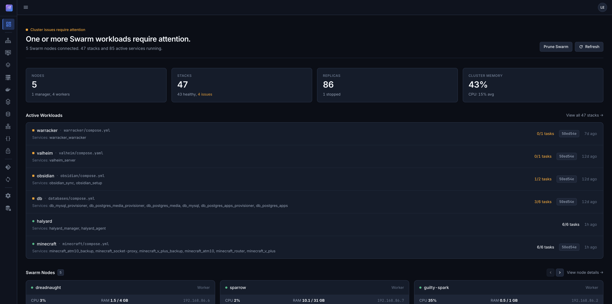

#  Halyard

**Docker Swarm GitOps & Observability Platform**



**Halyard** is a lightweight control plane and observability suite built specifically for **Docker Swarm** clusters. Standard Swarm APIs expose cluster-level service specs cleanly, yet hide node-local reality—live host telemetry, local volumes and bind mounts, container shells, image storage, and OS package state. Halyard bridges that gap with a **Manager–Agent architecture** paired with a built-in **GitOps reconciliation engine** and **automated image update polling**.

---

## Key Capabilities

- **Cluster-Wide Observability**: Real-time node CPU/memory telemetry, 24-hour historical ApexCharts, a live Swarm Visualizer node-topology board, and overlay/bridge IP usage tracking.
- **Workloads, Logs & Terminal**: Unified management of Swarm stacks, services, and containers—including viewport-bounded ANSI log streaming and an interactive `xterm.js` container shell directly in the browser.
- **Storage, Images & OS Maintenance**: Inspect node-local and NFS/bind mounts with an interactive **Volume Explorer** file browser, run remote registry image digest checks across multi-arch nodes, prune cluster-wide resources, and stream live host `apt` package upgrades with drain-and-reboot controls.
- **Automated GitOps Reconciliation**: Connect remote Git repositories, browse branches and compose files right in the UI, pull sibling `.env` / config assets, and continuously sync Swarm stacks on a configurable concurrency and interval schedule.
- **Image Update Polling & Rolling Restarts**: Deduplicated registry manifest checks across unique image/platform pairs, automated node pulls, and optional zero-downtime Swarm rolling restarts (`Update Stacks`).
- **Registry Quotas & Multi-Theme UI**: Live Docker Hub pull-rate meters, registry presets, per-user ANSI log color palettes, **Deep Slate** (dark) / **Alabaster** (light) / **System** themes, and responsive desktop and mobile layouts.

---

## Architecture

Halyard pairs one Manager replica with a global Agent deployed on every Swarm node:

```text
  Browser UI (Vue 3 + Vuetify 3 + TypeScript)
        │  HTTP / WebSocket / SSE
        ▼
  Halyard Manager (:8080, published as :8888 in default stack)
   ├── Embedded SQLite (/data/halyard.db) — users, repos, syncs, settings
   ├── GitOps Worker & Image Poller
   └── Docker Engine API (cluster state, Swarm stacks/services/networks/configs/secrets)
        │
        │  Overlay Network (:9090, authenticated via HALYARD_AGENT_TOKEN)
        │  ▲  15s Node Heartbeat (/api/internal/heartbeat)
        ▼
  Halyard Agent (mode: global on every manager & worker node)
   ├── Host telemetry (/proc, /sys, /etc) & live 24h metrics
   ├── Volume file browser & mount detection (/var/lib/docker/volumes)
   ├── Local container logs & WebSocket PTY terminal exec
   └── Image inventory, pulls, pruning, and live OS package updates
```

---

## Quick Start

Deploy Halyard to your Docker Swarm cluster using the bundled stack definition:

```bash
export HALYARD_AGENT_TOKEN="$(openssl rand -hex 32)"
docker stack deploy -c deploy/docker-stack.yml halyard
```

1. Open `http://<manager-ip>:8888` (or your configured Traefik route) in your browser.
2. Complete the first-run **Onboarding** setup to create your primary operator account.
3. Add a repository under **GitOps → Repositories** and create a stack mapping under **GitOps → Git Syncs**.

> See [Getting Started & Deployment](docs/getting-started.md) for environment variables, multi-architecture builds (`linux/amd64`, `linux/arm64`), and reverse proxy labels.

---

## Documentation

| Guide | Covers |
| --- | --- |
| **[Documentation Index](docs/README.md)** | Full table of contents across all platform guides |
| **[Getting Started & Deployment](docs/getting-started.md)** | Architecture, `deploy/docker-stack.yml`, env vars, multi-arch builds, onboarding, login |
| **[Cluster Observability & Nodes](docs/cluster-observability.md)** | Dashboard, Swarm Visualizer, cluster pruning, node join tokens, 24h charts, OS updates |
| **[Workloads, Logs & Terminal](docs/workloads.md)** | Stacks, Services, Containers, split Image/SHA fields, WebSocket logs, `xterm.js` shell |
| **[Storage, Images & Networking](docs/storage-and-networking.md)** | Volumes, Volume Explorer, deduplicated Node Images, Network IP usage, Configs, Secrets |
| **[GitOps Reconciliation](docs/gitops.md)** | Git repositories, connection testing, compose file browser, Additional Files, Git Syncs |
| **[Settings, Image Polling & Security](docs/settings-and-security.md)** | Appearance themes, GitOps concurrency, Image Update Polling, Registries & Docker Hub quotas, User Profile |

---

## Feature Roadmap

- [x] **Automated GitOps Engine**: Continuous stack sync from Git with branch and compose file browsing
- [x] **Multi-Node Observability**: Live metrics, Swarm Visualizer, and 24-hour node history charts
- [x] **Container Logs & Terminal**: WebSocket log viewer (custom ANSI palette) and interactive `xterm.js` shell
- [x] **Volume Explorer & Cluster Pruning**: Node-local file browser and cluster-wide resource cleanup
- [x] **Registry Rate-Limit Meters**: Live Docker Hub quota gauges and multi-registry presets
- [x] **Image Update Polling**: Deduplicated multi-arch registry checks, node pulls, and rolling restarts
- [x] **Network IP Usage**: Real-time subnet utilization tracking and endpoint inspection
- [x] **Node OS Updates**: Live SSE package upgrades with drain-and-reboot safety flows
- [ ] **Git Webhooks**: Instant reconciliation triggered on repository push events
- [ ] **OIDC / LDAP Authentication**: External identity provider integration
- [ ] **Self-Managing Stacks**: Allow Halyard to self-update through its own GitOps pipeline

---

## License

Distributed under the MIT License. See `LICENSE` for details.
