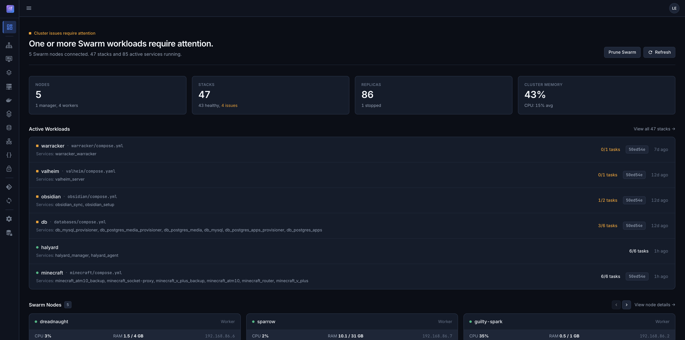
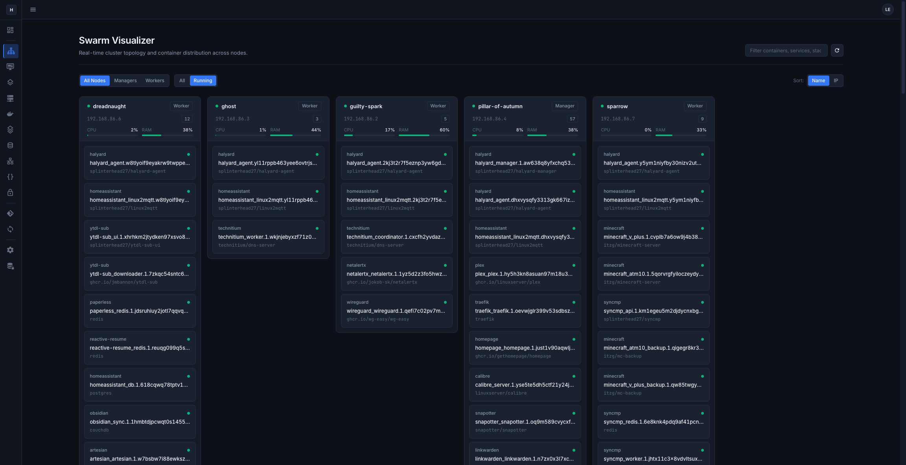
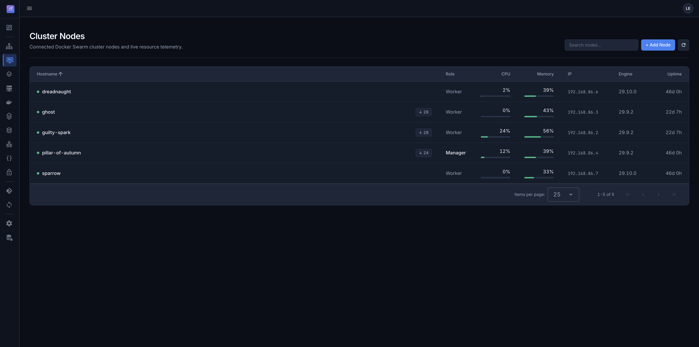
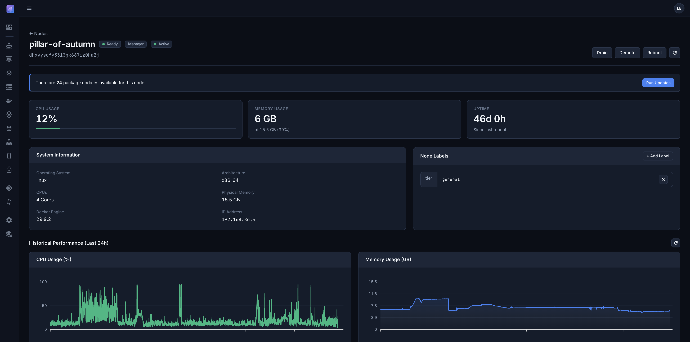

# Cluster Observability & Nodes

Halyard aggregates Swarm manager state and per-node agent metrics so you can inspect cluster health, container distribution, and host hardware from one interface.

---

## Cluster Overview (Dashboard)

The home view (`/`) surfaces high-signal operational status before drilling into individual resources:

- **Hero Status Banner**: Summarizes whether all cluster systems are healthy or require attention, alongside active node, stack, and service counts.
- **KPI Metric Cards**: Clickable summary cards linking directly to filtered domain views:
  - **Nodes**: Total nodes, manager/worker split, and offline warning count.
  - **Stacks**: Healthy vs. degraded stack counts.
  - **Replicas**: Running vs. stopped containers across the cluster.
  - **Cluster Memory**: Average memory utilization alongside average CPU load.
- **Active Workloads**: Highlights degraded stacks first followed by recently updated workloads, showing Git compose file paths, constituent service names, `running/total tasks`, short commit SHAs, and relative timestamps. Click any row to open its [Stack Detail](workloads.md#stacks--stack-detail).
- **Swarm Nodes Carousel**: Paginated 3-card strip displaying live node readiness, Swarm role, CPU %, RAM used/total, and node IP. Click any node card to open [Node Detail](#node-detail--os-updates).
- **GitOps Synchronization Bar**: Reports how many synced stacks match remote branches (`All up to date` or `<N> drift detected`), linking straight to [Git Syncs](gitops.md#git-syncs).

### Cluster-Wide Pruning

Click **Prune Swarm** in the dashboard header to open **Prune Swarm Resources**, where independent toggle switches let you reclaim unused assets across all connected nodes simultaneously:

- **Unused Containers** — Stopped containers not backing active services
- **Unused Networks** — Networks with no attached containers
- **Dangling Images** — Untagged image layers
- **All Unused Images (`-a`)** — Revealed when Dangling Images is enabled; also removes tagged images with no active container
- **Unused Volumes** *(Caution)* — Local volumes not attached to any container

---

## Swarm Visualizer

The **Visualizer** (`/swarm/visualizer`) maps running and exited containers onto columns representing each node in the cluster:

- **Node Column Headers**: Show health indicator, hostname, `Manager` / `Worker` role, IP address, matching container count pill, and live **CPU** / **RAM** progress bars. Click a node header to jump to **Node Detail**.
- **Container Tiles**: Group stack name, container state dot (**Running** green, **Exited** red, **Paused / Restarting** amber), container name, and image reference. Outdated containers display an **Image update available** notice. Click any tile to jump to [Container Detail](workloads.md#containers-live-logs--interactive-terminal).
- **Toolbar Filters**: Narrow results in real time by search text, role (**All Nodes**, **Managers**, **Workers**), container state (**All**, **Running**), and column sort order (**Name**, **IP**).

---

## Cluster Nodes

The **Nodes** table (`/swarm/nodes`) tracks every host joined to the Swarm:

Key columns include:

- **Node & Role**: Readiness status dot, hostname, and `Manager` / `Worker` role.
- **Alerts**: Compact status badges indicating pending OS package updates (`↓ N`) and whether a system reboot is required (`↻`).
- **CPU & Memory**: Live threshold progress bars with exact `used / total` memory details on hover.
- **IP Address, Engine & Uptime**: Overlay IP, Docker Engine version, and host uptime since last reboot.

### Adding a Node

Click **+ Add Node** to retrieve live Docker Swarm join tokens and copy ready-to-run `docker swarm join` commands for **Worker Node (Recommended)** or **Manager Node (Quorum Member)**, alongside firewall reminders (`2377/tcp`, `7946/tcp/udp`, `4789/udp`).

---

## Node Detail & OS Updates

Clicking any node opens its detail dashboard (`/swarm/nodes/:id`):

### Live Alerts, Metrics & 24h Charts

- **Alert Banners**: Automatically surface at the top when the node has pending OS updates (**Run Updates**) or requires a reboot (**Reboot Now**).
- **KPI Cards & System Info**: Show real-time CPU usage, Memory usage (`used` of `total`), Uptime, OS, CPU architecture, physical cores, total RAM, Docker Engine version, and IP address.
- **Historical Performance (Last 24h)**: Dual interactive ApexCharts graphs plotting rolling 24-hour CPU Usage (%) and Memory Usage (GB).

### Swarm Lifecycle & Label Management

- **Availability Controls**: Switch scheduling between **Drain** (evacuate and block new tasks) and **Activate** (restore scheduling) with confirmation prompts.
- **Role Controls**: **Promote** a worker to manager quorum or **Demote** a manager back to worker.
- **Node Labels**: Add (`+ Add Label`) or delete (`×`) custom Docker Swarm placement labels (for example, `tier=general` for service placement constraints) without SSH access.

### Running OS Updates & Safe Reboots

1. Click **Run Updates** on a node showing pending `apt` updates.
2. Review the list of pending packages (scrollable up to `80vh` for large update sets) and click **Confirm Update**.
3. Halyard streams live per-package upgrade progress over Server-Sent Events (`pending` → `success` / `error`), enables the **Done** button once finished, and immediately rescans node status.
4. Click **Reboot** (or **Reboot Now** on the warning banner) to choose between **Drain & Reboot** (recommended to gracefully drain tasks first) or **Reboot Immediately**.

---

← [Getting Started](getting-started.md) · Next: **[Workloads: Stacks, Services & Containers](workloads.md)** →
