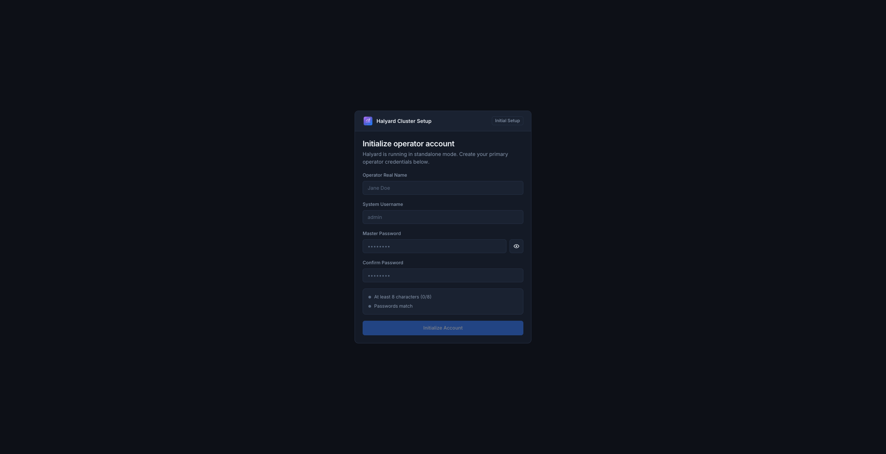
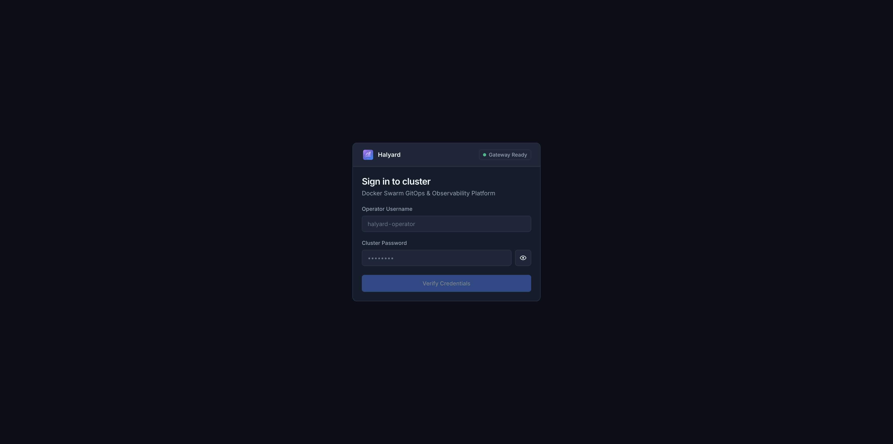

# Getting Started & Deployment

Halyard runs directly inside your Docker Swarm cluster as two coordinated Go services paired with an embedded Vue 3 SPA.

---

## Architecture Overview

Docker Swarm's Manager API exposes cluster-wide orchestration state (stacks, services, configs, secrets, overlay networks), yet node-local storage, `/proc` metrics, image inventories, and container stdio streams reside on each individual Docker host.

Halyard resolves this with two roles:

- **Halyard Manager (`cmd/manager`, port `8080`)**
  - Serves the frontend UI and primary REST/WebSocket API.
  - Persists users, preferences, Git repositories, Git syncs, and system settings in an embedded SQLite database at `/data/halyard.db`.
  - Runs the `GitWorker` reconciliation loop and the background `ImagePoller`.
  - Routes node-local operations to the appropriate Agent over the Swarm overlay network using cached agent IPs.
- **Halyard Agent (`cmd/agent`, port `9090`, `mode: global`)**
  - Runs one container per manager and worker node.
  - Registers itself via a 15-second heartbeat (`POST /api/internal/heartbeat`) to `MANAGER_URL` using `HALYARD_AGENT_TOKEN`.
  - Collects host CPU/memory/uptime metrics, inspects local volumes and `/var/lib/docker/volumes` directory trees, streams container logs/PTY sessions, manages local image pulls/removals, and streams OS `apt` updates.

---

## Deploying to Docker Swarm

The repository includes a ready-to-use Swarm compose stack at `deploy/docker-stack.yml`:

```yaml
services:
  manager:
    image: halyard-manager:latest
    environment:
      HALYARD_AGENT_TOKEN: ${HALYARD_AGENT_TOKEN:-default-internal-token-change-me}
    networks:
      - halyard
    ports:
      - 8888:8080
    volumes:
      - /var/run/docker.sock:/var/run/docker.sock
      - halyard_data:/data
    deploy:
      placement:
        constraints:
          - node.role == manager
      labels:
        - traefik.enable=true
        - traefik.http.routers.halyard.rule=Host(`halyard.example.com`)
        - traefik.http.services.halyard.loadbalancer.server.port=8080

  agent:
    image: halyard-agent:latest
    environment:
      HOST_PROC: /host/proc
      HOST_SYS: /host/sys
      HOST_ETC: /host/etc
      HALYARD_AGENT_TOKEN: ${HALYARD_AGENT_TOKEN:-default-internal-token-change-me}
    networks:
      - halyard
    volumes:
      - /var/run/docker.sock:/var/run/docker.sock
      - /var/lib/docker/volumes:/var/lib/docker/volumes:ro
      - /proc:/host/proc:ro
      - /sys:/host/sys:ro
      - /etc:/host/etc:ro
    deploy:
      mode: global
```

Deploy with a strong shared token:

```bash
export HALYARD_AGENT_TOKEN="$(openssl rand -hex 32)"
docker stack deploy -c deploy/docker-stack.yml halyard
```

### Environment Variables

| Variable | Component | Purpose | Default |
| --- | --- | --- | --- |
| `HALYARD_AGENT_TOKEN` | Manager & Agent | Shared secret authenticating Manager → Agent and heartbeat requests | *Required in production* |
| `MANAGER_URL` | Agent | URL used by Agents to send 15s heartbeats | `http://manager:8080` |
| `NODE_HOSTNAME` | Agent | Overrides detected Swarm host name reported to the Manager | Docker `Info.Name` |
| `HOST_PROC` / `HOST_SYS` / `HOST_ETC` | Agent | Read-only host mount paths for CPU, memory, and uptime collection | Host paths via `/host/*` |

### Building Multi-Architecture Images

The included `Makefile` automates building local images or pushing multi-architecture manifests (`linux/amd64` and `linux/arm64`) for mixed clusters (such as Intel/AMD servers alongside Raspberry Pi nodes):

- `make build-all` — Build local Manager and Agent images.
- `make push-multi` — Build and push `linux/amd64,linux/arm64` images using `docker buildx`.

---

## Onboarding & Authentication

### First-Run Onboarding

When Halyard boots with an empty database (zero registered users), any route automatically redirects to `/onboarding`.



Create the initial operator account by providing:

- **Operator Real Name**: Used for display and header avatar initials.
- **System Username**: Alphanumeric characters, underscores, and hyphens (`[a-zA-Z0-9_-]+`).
- **Master Password**: Minimum 8 characters, validated live alongside confirmation matching before clicking **Initialize Account**.

### Signing In

Once at least one user exists, unauthenticated sessions redirect to `/login`.



Enter your operator username and cluster password (with an inline visibility toggle) and click **Verify Credentials**. Sessions store a JWT/token in browser `localStorage` and remain signed in until logged out from the top-right user menu.

---

## Navigation & Layout

Halyard adapts cleanly between wide desktop displays and mobile viewports:

- **Desktop**: Collapsible left icon rail (`56px` collapsed / `220px` expanded via the top-left menu toggle) organized into **Dashboard**, **Swarm**, **GitOps**, and **Settings**, plus a top bar with the user avatar menu (**Profile Settings**, instant **Dark/Light Theme** toggle, and **Logout**).
- **Mobile**: Hamburger drawer toggle on top, **mobile card layouts** replacing dense desktop data tables, and a fixed bottom bar for quick switching between Dashboard, Visualizer, Stacks, Nodes, and Settings.

---

Next: **[Cluster Observability & Nodes](cluster-observability.md)** →
