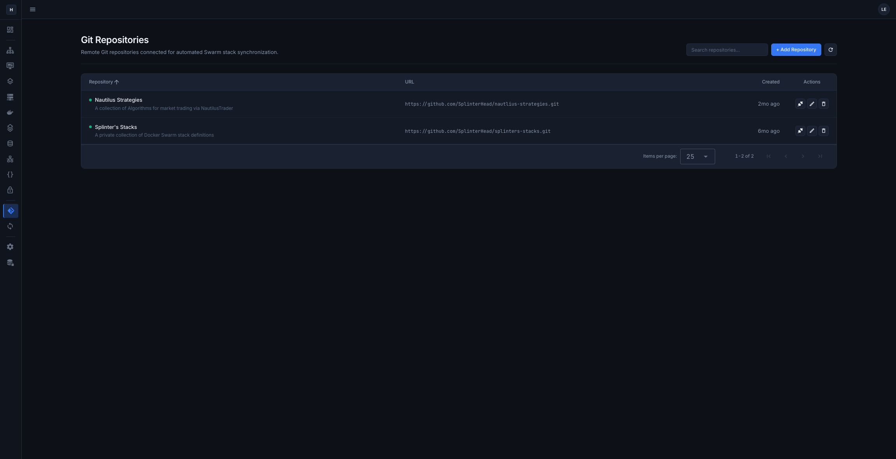
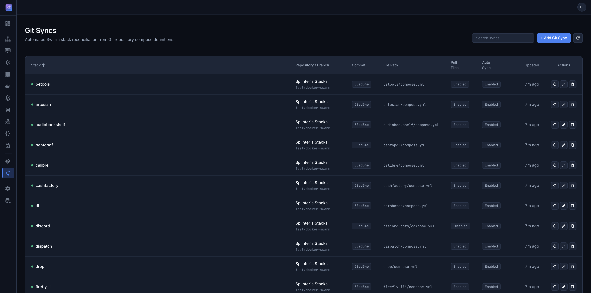

# GitOps Reconciliation

Halyard's GitOps engine continuously reconciles remote Git compose definitions with running Docker Swarm stacks, persisting repository metadata and sync state inside SQLite (`/data/halyard.db`).

---

## Git Repositories

Manage remote Git sources under **GitOps → Repositories** (`/git/repositories`):

### Connecting a Repository

Click **+ Add Repository** to register a repository:

- **Friendly Name**: Human-readable label displayed in Git Syncs and dashboard workloads.
- **Git URL**: Full clone URL (`https://github.com/org/repo.git`).
- **Username & Token / Password** *(Optional)*: Credentials for private HTTPS repositories.
- **Description**: Optional notes rendered cleanly beneath the repository name.

### Testing & Status

- **Test Connection**: Click the connection icon in a row's actions to verify remote reachability and authentication on demand.
- **Status Dot**: Displays **Green** when the last fetch/test succeeded or **Red** if authentication or network connectivity failed.
- **Delete Repository**: Removing a repository also deletes any **Git Syncs** bound to it (running Swarm stacks remain intact unless separately removed).

---

## Git Syncs

Map repositories and branches to deployed Docker Swarm stacks under **GitOps → Git Syncs** (`/git/syncs`):

### Table Columns & Status

- **Stack**: Status indicator (**Ready** / **Syncing** blue / **Out of Date** amber when remote drift or sync failure occurred) and target Swarm stack name.
- **Repository / Branch**: Linked repository friendly name and tracked Git branch.
- **Commit**: Short 7-character SHA badge of the last applied commit (or `Never`).
- **File Path**: Path to the compose file inside the repository.
- **Pull Files**: Shows whether **Additional Files** (such as sibling `.env` files) are pulled with the compose file.
- **Auto Sync**: Shows whether periodic background reconciliation is enabled.
- **Updated**: Relative timestamp of the latest reconciliation attempt.

### Creating or Editing a Sync

Click **+ Add Git Sync** (or edit an existing row) to configure:

1. **Stack Name**: Lowercase letters, numbers, and dashes (`my-app`).
2. **Git Repository & Branch**: Selecting a repository automatically loads its available remote branches.
3. **Compose File Path**: Enter a path manually or click **Browse** to open the **Browse Repository** modal—an interactive directory tree of the chosen branch that highlights `.yml` / `.yaml` files for one-click selection.
4. **Additional Files** *(Toggle switch)*: Pull sibling files (for example `.env`, config templates, or local assets) from the compose directory before deploying.
5. **Auto Sync** *(Toggle switch)*: Enable continuous periodic polling on the schedule configured in [System Settings](settings-and-security.md#gitops-reconciliation), or leave disabled for manual **Force Sync Now** deployments only.

### Manual & Automatic Reconciliation

- **Background Polling**: `GitWorker` periodically checks repositories for new commits on the configured **Sync Interval**, queuing eligible auto-sync stacks up to the **Sync Concurrency** limit.
- **Force Sync Now**: Click the sync button on any row to pull the latest commit immediately and reconcile the stack idempotently.

---

← [Storage, Images, Networks & Secrets](storage-and-networking.md) · Next: **[Settings, Image Polling & Security](settings-and-security.md)** →
