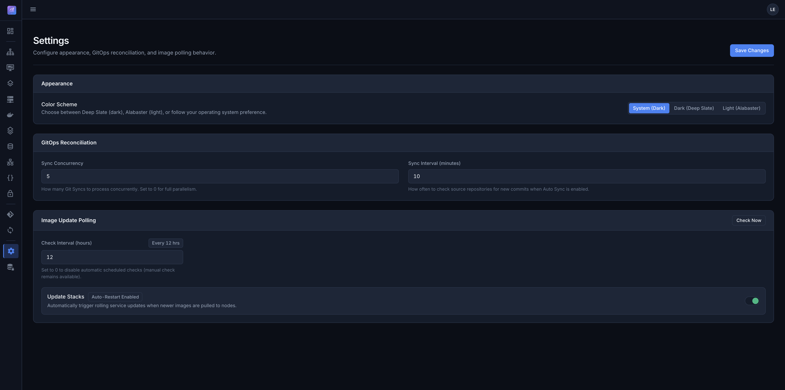
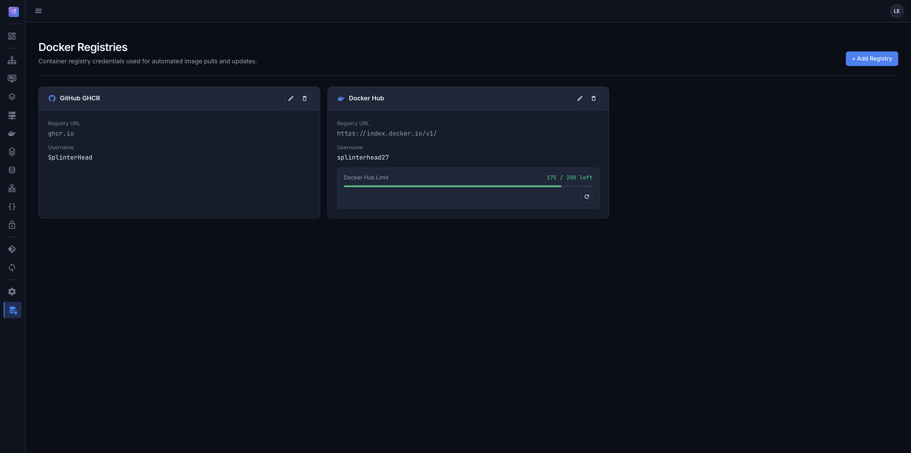
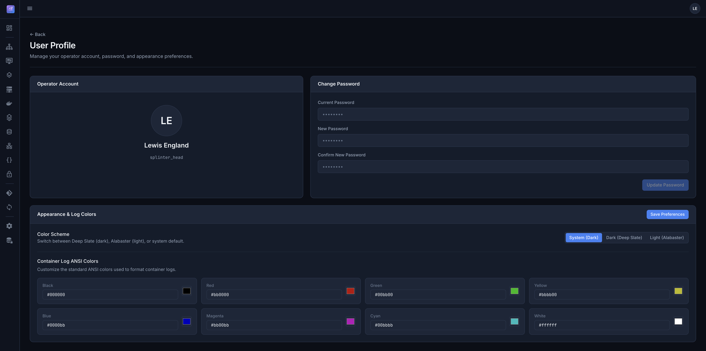

# Settings, Image Polling & Security

Global platform preferences, automated container image updates, registry credentials, and operator profile settings live under the **Settings** section and top-right user menu.

---

## System Settings (`/settings`)

Navigate to **Settings → Settings** to configure themes, GitOps scheduling, and container image update polling:

### 1. Appearance
Choose the active interface theme immediately with the **Color Scheme** segmented control:
- **System** — Tracks your OS light/dark preference (`Deep Slate` or `Alabaster`)
- **Dark (Deep Slate)** — High-contrast dark slate surfaces
- **Light (Alabaster)** — Neutral light surfaces

You can also toggle between dark and light themes directly from the top-right user avatar menu.

### GitOps Reconciliation
- **Sync Concurrency (`0`–`20`)**: Maximum number of Git Syncs processed simultaneously (`0` allows unrestricted parallelism).
- **Sync Interval (`1`–`60` minutes)**: Polling interval for remote repositories when **Auto Sync** is enabled on a stack.

### 3. Image Update Polling (`ImagePoller`)
Halyard can automatically monitor upstream container registries for tag updates, pull new revisions to relevant Swarm nodes, and trigger zero-downtime rolling updates:

- **Check Interval (`0`–`72` hours)**: How often Halyard scans unique `(image, platform)` pairs across all Swarm nodes. Set to `0` to disable background polling while retaining manual checks.
- **Update Stacks** *(Toggle switch)*: When enabled (`Auto-Restart Enabled`), services backed by updated images are automatically restarted via native Docker Swarm rolling `ServiceUpdate` (clearing stale digest pins and respecting service update configs).
- **Check Now**: Immediately launches a cluster-wide image update poll and displays scanned images, updated image counts, and restarted services.

> Remember to click **Save Changes** in the page header after modifying GitOps Reconciliation or Image Update Polling settings.

---

## Docker Registries & Pull Quotas

Manage credentials for private registries and monitor Docker Hub rate limits under **Settings → Registries** (`/swarm/registries`):

### Supported Presets & Credentials
Click **+ Add Registry** to configure credentials manually or populate settings from built-in presets:
- Docker Hub (`https://index.docker.io/v1/`)
- GitHub Container Registry (`ghcr.io`)
- GitLab Container Registry (`registry.gitlab.com`)
- AWS ECR (Private / Public)
- Google Artifact Registry (`us-central1-docker.pkg.dev`) & Google Container Registry (`gcr.io`)
- Red Hat Quay (`quay.io`)
- Azure Container Registry (`*.azurecr.io`)

### Docker Hub Rate-Limit Monitoring
- **Anonymous Warning Banner**: Appears when no Docker Hub credential is saved, displaying remaining anonymous IP pulls, reset countdown, and a quick **Authenticate Docker Hub** shortcut.
- **Docker Hub Limit Meter**: Embedded inside Docker Hub cards with remaining pull quota (`remaining / limit left`), threshold fill bar, reset countdown, and manual refresh button.

---

## User Profile & ANSI Log Colors

Open **Profile Settings** (`/settings/profile`) from the top-right user avatar menu:

- **Operator Account**: Displays your avatar initials badge, Real Name, and Username.
- **Change Password**: Verify your current password and enter a new password (minimum 8 characters) to update login credentials.
- **Appearance & Log Colors**:
  - Switch your **Color Scheme** (`System`, `Dark (Deep Slate)`, `Light (Alabaster)`).
  - Customize all 8 standard ANSI foreground colors (`Black`, `Red`, `Green`, `Yellow`, `Blue`, `Magenta`, `Cyan`, `White`) using hex values or color pickers, then click **Save Preferences**. These colors are applied directly to container log streams in [Container Detail Logs](workloads.md#2-logs-tab).

---

← [GitOps Reconciliation](gitops.md) · [Documentation Index](README.md)
