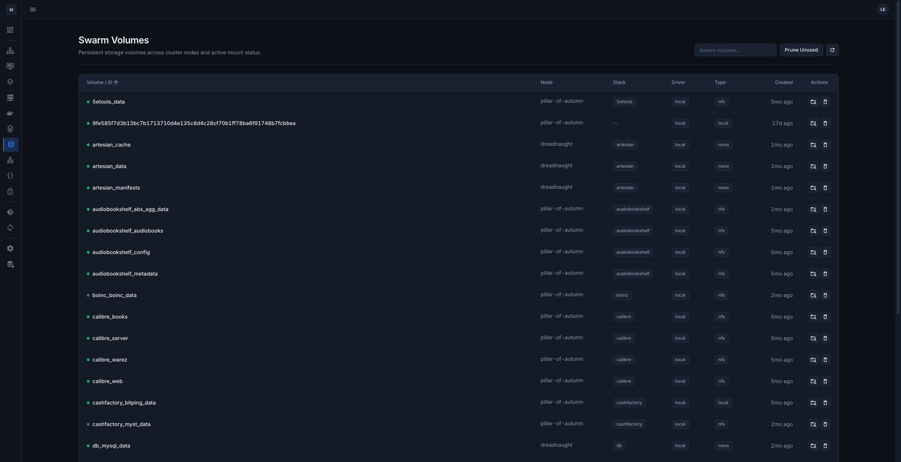
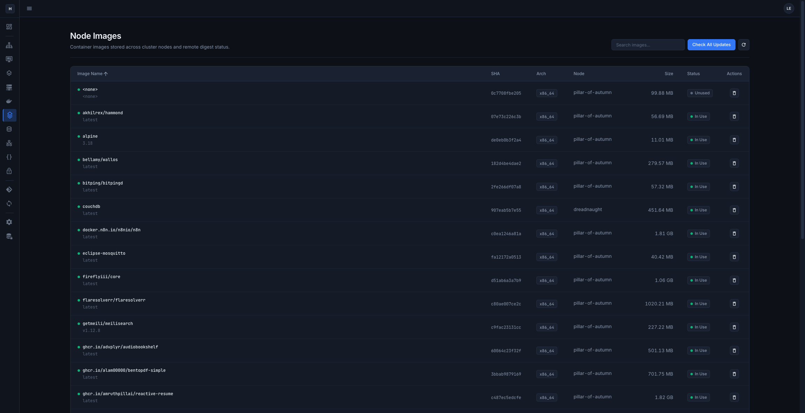
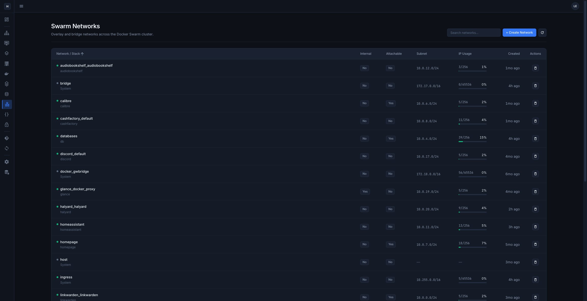
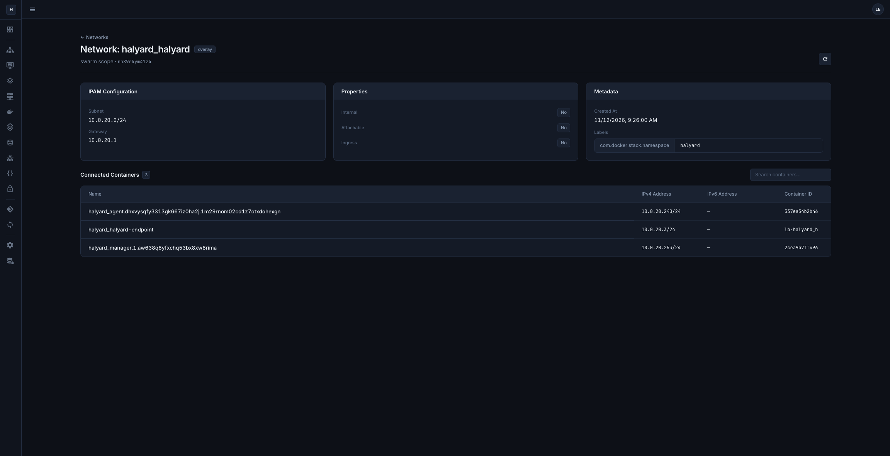
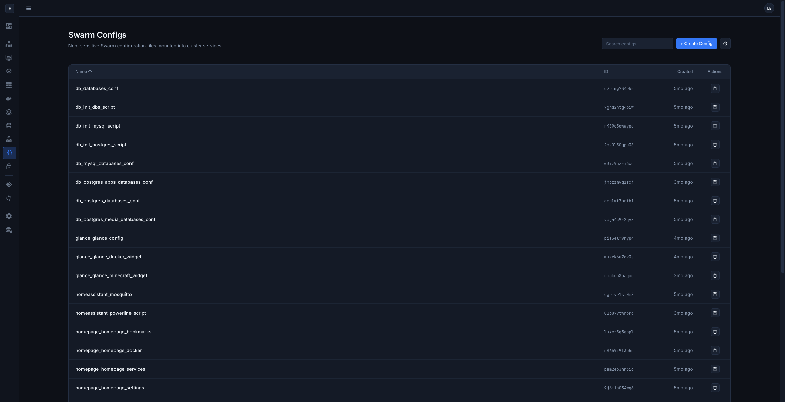
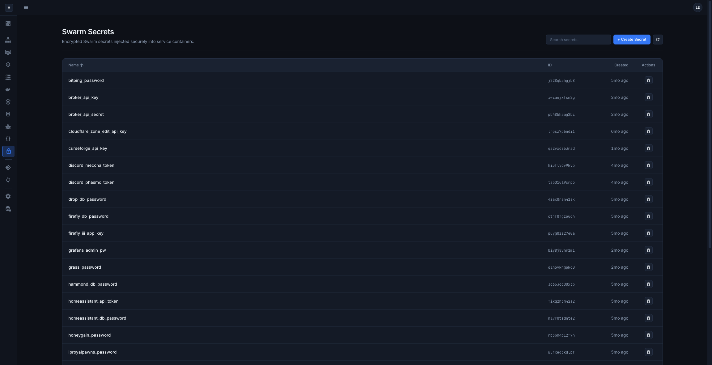

# Storage, Images, Networks & Secrets

Halyard pairs node-agent inspection with Docker Swarm's cluster APIs to expose volumes, images, overlay networks, configs, and secrets in one place.

---

## Volumes & Volume Explorer

Because Swarm's manager API alone cannot report per-node local volumes across workers, Halyard's agents inspect mounts on every host and surface a unified **Swarm Volumes** table (`/swarm/volumes`):

### Volume Detection & Actions
- **Status & Metadata**: Shows an **In Use** green dot whenever a volume is mounted by at least one container, plus **Node**, owning **Stack** badge, **Driver** (`local` or 3rd-party plugins), **Type** (`local`, `nfs`, `bind`, `gluster`), and **Created** timestamp.
- **Prune Unused**: Reclaim all unattached volumes across every node in the cluster via a confirmation modal.
- **Delete Volume**: Safely deletes an unused volume through its host node agent (Docker Engine locks prevent deletion if containers still reference the mount).

### Interactive Volume Explorer

Click the folder search icon (**Browse Volume Files**) on any row to launch the **Volume Explorer** modal directly against that node's `/var/lib/docker/volumes` directory tree:

- Traverse folders with clickable breadcrumb paths
- Filter files in the active directory
- View file names, formatted byte sizes, last-modified timestamps, and UNIX permissions

---

## Node Images & Digest Checks

The **Node Images** view (`/swarm/images`) aggregates image inventories across every Swarm node, deduplicated per `(node, repository, tag)` so multi-reference digest entries do not repeat:

- **Columns**: Image repository & tag (with remote update-check status dot), 12-character **SHA**, CPU **Arch** badge (`amd64`, `arm64`, etc.), **Node**, **Size**, **Status** (`In Use` / `Unused`), and delete action.
- **Check All Updates**: Queries remote registries (using credentials configured under [Docker Registries](settings-and-security.md#docker-registries--pull-quotas)) once per unique image/tag/architecture pair and marks images **Up to date** (green), **Out of date** (red), or **Checking** (amber).
- **Delete Docker Image?**: Shows full image details, warns when the image is currently in use, and includes a **Force delete image** (`docker rmi -f`) toggle switch.

---

## Networks & IP Usage

### Networks List (`/swarm/networks`)

The **Swarm Networks** view lists overlay, bridge, and host networks cluster-wide alongside live subnet capacity:

- **IP Usage Meter**: Calculates allocated vs. available addresses from each network's subnet and active endpoints (`used/total`, percentage, and color-coded bar).
- **+ Create Network**: Modal supporting **Network Name**, **Driver** (`overlay` or `bridge`), **Attachable** and **Internal** toggle switches, optional CIDR **Subnet** & **Gateway**, and **Enable Encryption (IPSEC)** (shown for `overlay` networks).
- **Delete Network**: Removes unused networks with error details if active containers remain attached.

### Network Detail (`/swarm/networks/:id`)

Clicking any network opens **IPAM Configuration** (Subnet & Gateway), **Properties** (`Internal`, `Attachable`, `Ingress`), **Metadata** (Created At & aligned Labels), and a searchable **Connected Containers** table showing IPv4, IPv6, and Container IDs linked directly to **Container Detail**:

---

## Configs & Secrets

### Swarm Configs (`/swarm/variables`)

Manage non-sensitive configuration objects stored in Swarm (`docker config`):

- **Create Config**: Paste configuration content into a monospace editor under `+ Create Config`.
- **Inspect Config**: **Click any row** in the table to open the **View Config** modal and read its stored content.
- **Remove Config**: Delete unused configs (fails if currently referenced by an active service).

### Swarm Secrets (`/swarm/secrets`)

Manage encrypted Docker Swarm secrets injected into service containers under `/run/secrets/`:

- **Create Secret**: Add named secrets via `+ Create Secret` without echoing secret contents into shell history.
- **Remove Secret**: Delete obsolete secrets when no longer referenced by running services.

> Swarm secret payloads are write-only and are never displayed back in the Halyard UI once created.

---

← [Workloads](workloads.md) · Next: **[GitOps Reconciliation](gitops.md)** →
