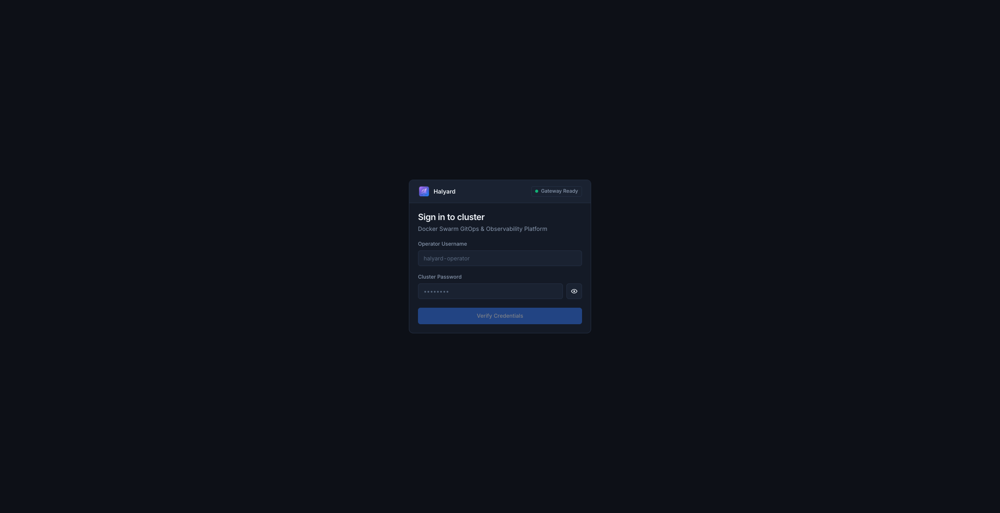

# Login

The authentication entry point for Halyard. Secures the platform from unauthorized access.

## Fields & Controls
- **Operator Username**: System username created during onboarding or profile setup.
- **Cluster Password**: Account password with an inline **Show/Hide password** toggle button.
- **Verify Credentials**: Authenticates against the manager (`/api/auth/login`) and stores the session token.

## Status Indicators
- **Gateway Ready** (Green): Indicates the Halyard authentication gateway is reachable.

## Dialogs
No dialogs are present on this view.
