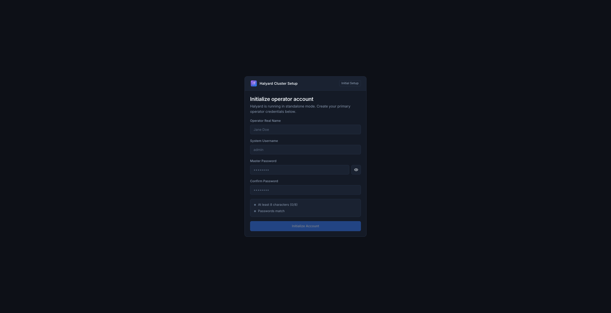

# Onboarding

Initial setup view presented when Halyard is started with no registered users. Allows creating the first administrator account.

## Fields & Controls
- **Operator Real Name**: Display name used for the profile summary and header initials avatar.
- **System Username**: Login identifier (alphanumeric characters, underscores, and hyphens only).
- **Master Password** / **Confirm Password**: Minimum 8 characters with live length and match validation indicators and an inline visibility toggle.
- **Initialize Account**: Creates the initial operator user and signs directly into the Dashboard.

## Dialogs
No dialogs are present on this view.
