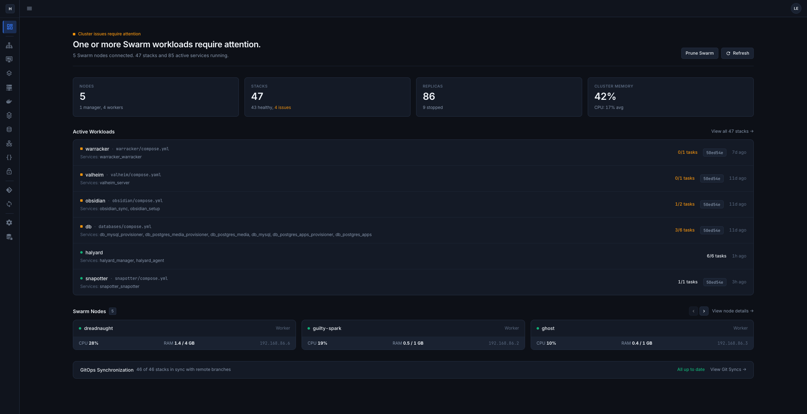

# Cluster Overview (Home)

The main dashboard providing a real-time summary of the Docker Swarm cluster's health, workloads, nodes, and GitOps synchronization status.

## Overview Sections
- **Hero Health Banner**: Reports overall cluster status (`All cluster systems healthy` or `Cluster issues require attention`) along with connected node, stack, and service counts.
- **Cluster Summary KPI Cards**: Clickable metric cards for **Nodes** (manager/worker/offline breakdown), **Stacks** (healthy vs. issues), **Replicas** (running vs. stopped), and **Cluster Memory / CPU** averages.
- **Active Workloads**: Highlights unhealthy stacks first followed by recently updated stacks, showing the Git compose file path (if synced), service list, running/total tasks, short Git commit SHA, and relative update time. Clicking a row opens [Stack Detail](/docs/wiki/05.stack-detail.md).
- **Swarm Nodes**: Three-card node carousel with **Previous/Next** pagination controls showing live status dot, role, CPU %, RAM usage, and IP address. Clicking a node card opens [Node Detail](/docs/wiki/09.node-detail.md).
- **GitOps Synchronization Bar**: Displays how many synced stacks are up to date with remote branches or have drift detected; clicking navigates to [Git Syncs](/docs/wiki/22.syncs.md).

## Buttons
- **Prune Swarm**: Opens the **Prune Swarm Resources** modal to reclaim unused cluster resources across all nodes.
- **Refresh**: Reloads cluster metrics, stacks, nodes, services, containers, and Git syncs from the manager.
- **View all N stacks → / View node details → / View Git Syncs →**: Shortcut links to the corresponding list views.

## Dialogs
- **Prune Swarm Resources**: Toggle switches for **Unused Containers**, **Unused Networks**, **Dangling Images**, **All Unused Images (-a)** (shown when Dangling Images is enabled), and **Unused Volumes** (marked Caution), with **Cancel** and **Prune** actions.
