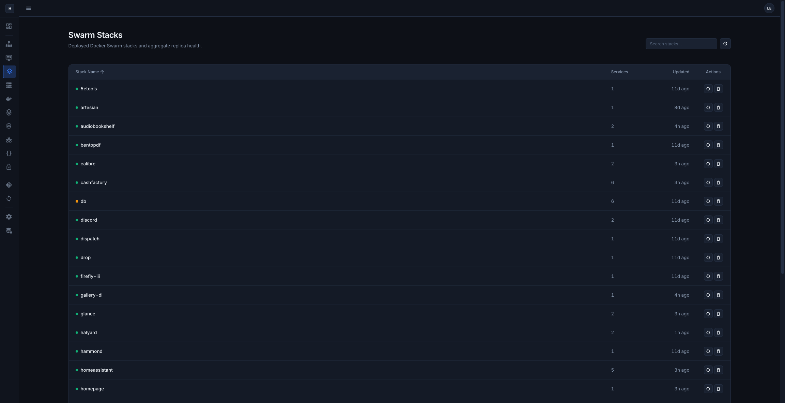

# Stacks

A list view of all orchestrated Docker Swarm deployments (Stacks) grouped by `com.docker.stack.namespace`, including standalone/manual services under `Orphaned/Manual`.

## Columns & Status Indicators
- **Stack Name**: Displays health dot (**Healthy** green vs. degraded amber) alongside the stack name.
- **Services**: Total number of services defined in the stack.
- **Updated**: Relative timestamp of the latest task/service update.
- **Actions**: Per-stack **Force Restart** and **Delete Stack** buttons (omitted for `Orphaned/Manual`).

## Row Actions
- **Clicking a row**: Navigates to [Stack Detail](/docs/wiki/05.stack-detail.md) for the selected stack.

## Buttons
- **Search Input**: Filters stacks by name or status.
- **Refresh**: Reloads the stack list from the manager.
- **Force Restart**: Triggers a force update on all services belonging to the stack.
- **Delete Stack**: Opens the confirmation modal to remove the stack.

## Dialogs
- **Delete Stack?**: Confirms removal of the stack and includes a **Delete associated volumes** toggle switch to permanently remove volumes created for the stack (**Cancel** / **Remove Stack**).
