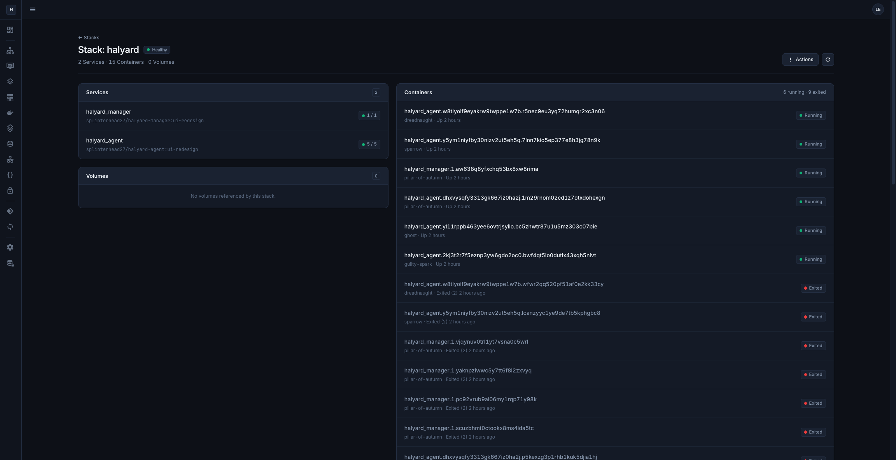

# Stack Detail

Deep inspection of a single Docker Swarm stack, showing its services, referenced volumes, containers, and cluster task history.

## Sections & Status Indicators
- **Services**: Lists each service in the stack with its image (without SHA digest) and `running / replicas` badge. Clicking a service navigates to [Service Detail](/docs/wiki/07.service-detail.md).
- **Volumes**: Shows volumes referenced by the stack, indicating whether each is **Managed** or **External**.
- **Containers**: Lists containers belonging to the stack along with running/exited summary, host node, status text, and state badge. Clicking a container opens [Container Detail](/docs/wiki/11.container-detail.md).
- **Cluster Tasks**: Searchable, paginated table (`25` items per page) showing **Service**, **Node**, **State** (`Running`, `Failed`, `Shutdown`, `Rejected`, `Orphaned`, `Starting`), **Desired** state, **Error / Status**, and **Updated** timestamp.

## Buttons
- **← Stacks**: Returns to the Stacks list.
- **Actions**: Dropdown menu (omitted for `Orphaned/Manual`) with **Force Restart**, **Stop (Scale to 0)**, **Start Services**, **Rollback Spec**, and **Delete Stack**.
- **Refresh**: Reloads stack details and task states from the manager.
- **Search Input**: Filters rows in the Cluster Tasks table.

## Dialogs
- **Delete Stack?**: Confirms removal of the stack and all associated services, with a **Delete associated volumes** toggle switch (**Cancel** / **Remove Stack**).
