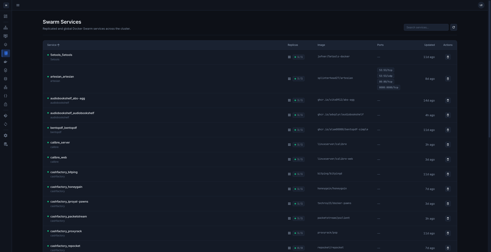

# Services

Cluster-wide inventory of all replicated and global Docker Swarm services.

## Columns & Status Indicators
- **Service**: Status dot (green when all desired replicas are running, red when 0 running with desired > 0, amber otherwise), service name, and stack subtitle (`No stack` if standalone).
- **Replicas**: Scheduling mode icon on the left (globe for `global`, four-square grid for `replicated`) beside the `running / desired` replica badge.
- **Image**: Image name/tag (truncated cleanly in monospace, full reference on hover).
- **Ports**: Published Swarm ingress/host ports rendered as badges.
- **Updated**: Relative timestamp of the last service update.
- **Actions**: Delete service button.

## Row Actions
- **Clicking a row**: Navigates to [Service Detail](/docs/wiki/07.service-detail.md).

## Buttons
- **Search Input**: Filters services by name, stack, or image.
- **Refresh**: Reloads services from the manager.
- **Delete Service**: Prompts confirmation to remove the service.

## Dialogs
- **Delete Service?**: Confirms permanent deletion of the selected service and all its tasks (**Cancel** / **Remove Service**).
- **Service Deletion Failed**: Displays any Docker API error returned if deletion fails.
