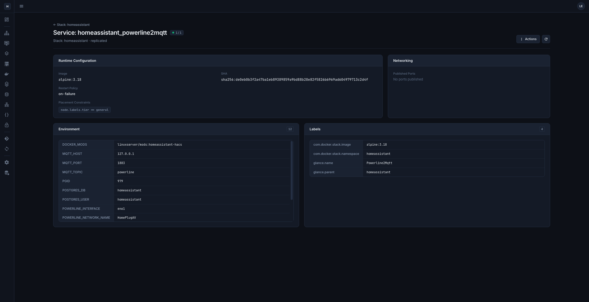

# Service Detail

Detailed inspection and lifecycle control for a single Docker Swarm service.

## Sections
- **Header**: Displays service name, `running / replicas` badge, stack namespace, and scheduling mode (`replicated` or `global`).
- **Runtime Configuration**: Shows **Image** (`image:tag`) and **SHA** (`sha256:...`) as separate fields, **Restart Policy**, and **Placement Constraints**.
- **Networking**: Lists all **Published Ports** for the service.
- **Environment**: Aligned key/value table of injected environment variables (`KEY=VALUE`).
- **Labels**: Aligned key/value table of Swarm service labels.

## Buttons
- **← Stack / Services**: Navigates back to the previous stack or services list.
- **Actions**: Dropdown menu containing **Force Restart**, **Stop (Scale to 0)**, **Start Service**, **Rollback Spec**, **Scale Service** (`Stop`, `Start`, and `Scale` are disabled for `global` services), and **Delete Service**.
- **Refresh**: Reloads service configuration from the manager.

## Dialogs
- **Scale Service**: Numeric **Desired Replicas** input to scale replicated services dynamically (**Cancel** / **Scale**).
- **Delete Service?**: Confirms permanent deletion of the service (**Cancel** / **Remove Service**).
