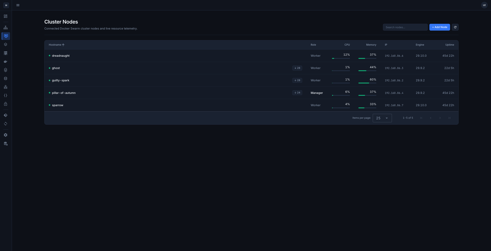

# Nodes

List of all physical or virtual machines participating in the Docker Swarm cluster with live telemetry from Halyard agents.

## Columns & Status Indicators
- **Node**: Status dot (**Ready** green / other red) and hostname.
- **Alerts**: Compact badges indicating pending OS package updates (`↓ N`) and whether a system reboot is required (`↻`).
- **Role**: `Manager` or `Worker`.
- **CPU**: Live CPU utilization percentage and threshold telemetry bar.
- **Memory**: Live memory usage percentage and threshold telemetry bar (exact used/total tooltip on hover).
- **IP Address**: Node overlay/management IP in monospace.
- **Engine**: Installed Docker Engine version.
- **Uptime**: Formatted host uptime since last reboot.

## Row Actions
- **Clicking a row**: Navigates to [Node Detail](/docs/wiki/09.node-detail.md) for the selected node.

## Buttons
- **Search Input**: Filters nodes by hostname, role, or IP address.
- **+ Add Node**: Opens the **Add Node to Swarm Cluster** modal with worker and manager join commands.
- **Refresh**: Reloads node telemetry from the manager.

## Dialogs
- **Add Node to Swarm Cluster**: Fetches live Swarm join tokens and displays copyable `docker swarm join` commands for **Worker Node (Recommended)** and **Manager Node (Quorum Member)** along with required firewall ports (`2377/tcp`, `7946/tcp/udp`, `4789/udp`).
