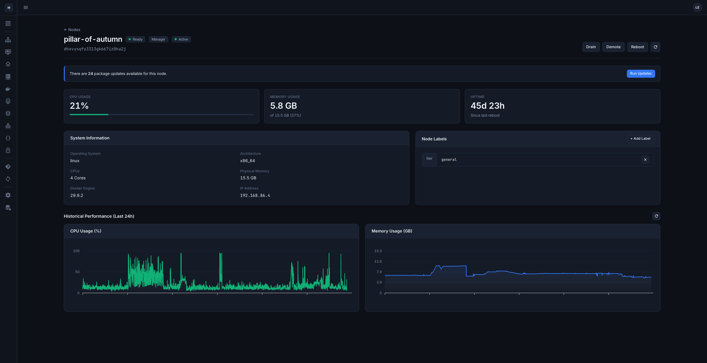

# Node Detail

Detailed telemetry, historical resource charts, label management, Swarm role/availability controls, and OS update execution for a single Swarm node.

## Sections & Status Indicators
- **Header Badges**: Node status (**Ready** green / red), role (`Manager` or `Worker`), and availability (**Active** green, **Pause** amber, **Drain** red).
- **Alert Banners**:
  - **Restart Required**: Amber warning banner with a **Reboot Now** shortcut when the host requires a restart after updates.
  - **Pending Package Updates**: Info banner showing pending OS update count with a **Run Updates** button.
- **Summary Metric Cards**: Real-time **CPU Usage** (percentage + bar), **Memory Usage** (`used` of `total`), and **Uptime**.
- **System Information**: Operating System, Architecture, CPUs (Cores), Physical Memory, Docker Engine version, and IP Address.
- **Node Labels**: Lists custom Swarm node labels with inline removal buttons (`×`) and an **+ Add Label** action.
- **Historical Performance (Last 24h)**: Interactive ApexCharts time-series graphs for CPU Usage (%) and Memory Usage (GB).

## Buttons
- **← Nodes**: Returns to the Nodes list.
- **Drain / Activate**: Toggles Swarm scheduling availability between `drain` and `active`.
- **Promote / Demote**: Changes node Swarm role between `worker` and `manager`.
- **Reboot**: Opens reboot confirmation with immediate or drain-first options.
- **Refresh**: Reloads node status and metrics.
- **+ Add Label / × (Remove)**: Creates or deletes custom Swarm node labels.
- **Run Updates**: Opens the OS package update stream dialog.

## Dialogs
- **Run System Updates**: Displays pending OS packages (`80vh` max-height scrollable panel), streams live `apt-get` update progress per package via SSE (`pending` / `success` / `error`), and finishes with a **Done** button and immediate rescan.
- **Reboot Node**: Offers **Cancel**, **Reboot Immediately**, or **Drain & Reboot** to reschedule active containers safely before rebooting.
- **Add Node Label / Delete Label?**: Key/value form and deletion confirmation for node placement labels.
- **Swarm Action Confirmation**: Confirmation dialog for Drain, Activate, Promote, and Demote actions.
