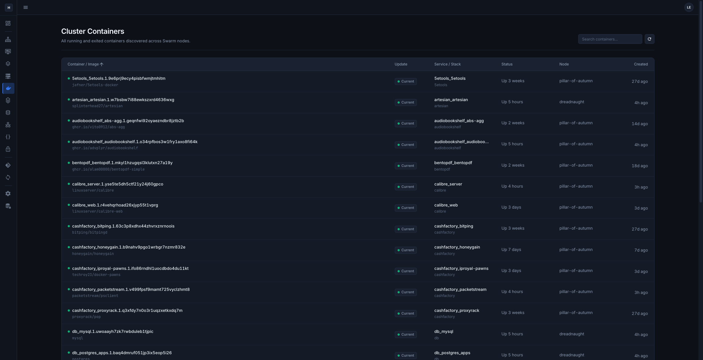

# Containers

Cluster-wide inventory of all running and exited containers discovered across Swarm nodes.

## Columns & Status Indicators
- **Container / Image**: Container state dot (**Running** green, **Exited** red, **Paused / Restarting** amber), container name, and image name below in monospace.
- **Update**: Displays whether the container's running image digest matches the latest local/checked tag (**Current** green vs. **Out of Date** amber).
- **Service / Stack**: Owning Swarm service and stack namespace.
- **Status**: Runtime status summary (e.g., `Up 2 days`).
- **Node**: Hostname of the Swarm node running the container.
- **Created**: Relative creation timestamp.

## Row Actions
- **Clicking a row**: Navigates to [Container Detail](/docs/wiki/11.container-detail.md).

## Buttons
- **Search Input**: Filters containers by name, image, service, stack, status, or node.
- **Refresh**: Reloads containers across all cluster nodes.

## Dialogs
No dialogs are present on this view.
