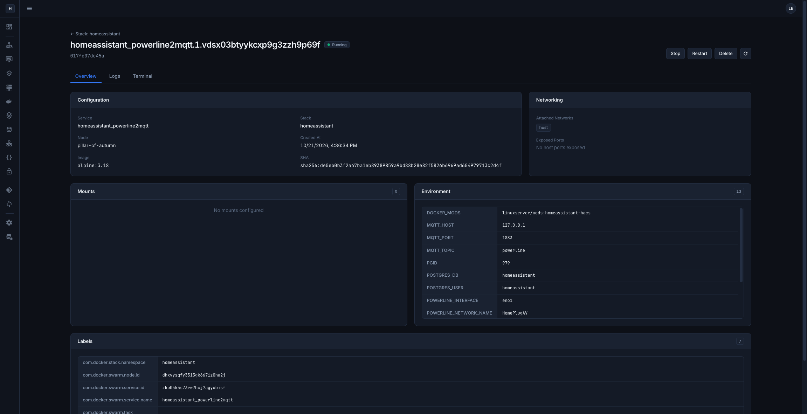

# Container Detail

Comprehensive inspection, lifecycle control, live WebSocket log streaming, and interactive shell terminal access for an individual container.

## Tabs
- **Overview**:
  - **Configuration**: Service, Stack, Node, Created At, and split **Image** (`image:tag`) and **SHA** (`sha256:...`) fields.
  - **Networking**: Attached Docker networks and exposed host/container port mappings.
  - **Mounts**: Table of volume and bind mounts showing Source, Destination, and Type (`volume`, `bind`, etc.; plus RW/RO on mobile cards).
  - **Environment** & **Labels**: Aligned key/value tables of runtime environment variables and container labels.
- **Logs**:
  - Live WebSocket log viewer bounded to the viewport so it never forces outer page scrolling.
  - Supports **Line Numbers** and **Timestamps** toggle switches, **Auto-scroll**, **Clear**, and ANSI color rendering customized in [User Profile](/docs/wiki/24.profile.md).
- **Terminal**:
  - Interactive WebSocket PTY console powered by `xterm.js` and bounded to the viewport, with shell selection (`/bin/bash`, `/bin/sh`, `/bin/zsh`, `/bin/ash`) and **Connect / Disconnect** control.

## Buttons
- **← Stack / Containers**: Returns to the previous view.
- **Stop / Start**, **Restart**, **Delete**, **Refresh**: Container lifecycle controls in the page header.

## Dialogs
- **Stop Container? / Restart Container?**: Lifecycle confirmation dialogs.
- **Delete Container?**: Removal confirmation with a **Force delete** toggle switch to kill running containers.
- **Operation Failed**: Displays any Docker daemon error message if a lifecycle action fails.
