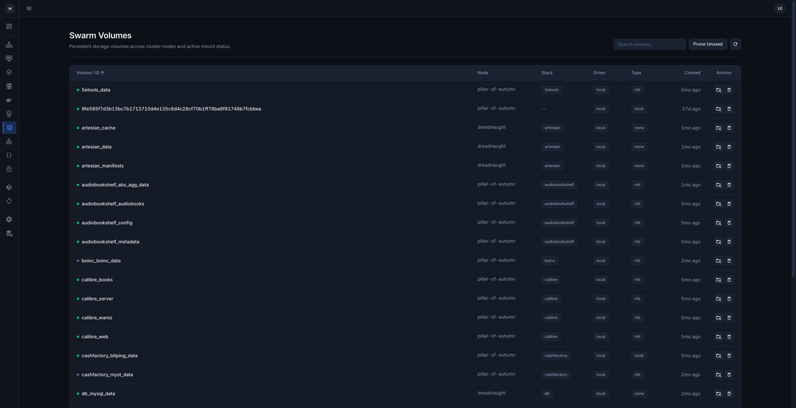

# Volumes

Unified inventory of persistent storage volumes across all Swarm nodes, including mount status and node-local file browsing.

## Columns & Status Indicators
- **Volume Name**: Status dot (**In Use** green dot when mounted by at least one container) and friendly volume name.
- **Node**: Swarm node hosting the volume.
- **Stack**: Associated stack namespace badge (or `—` for standalone volumes).
- **Driver**: Storage driver (`local`, third-party plugins, etc.).
- **Type**: Detected volume mount type (`local`, `nfs`, `bind`, `gluster`, etc.).
- **Created**: Relative creation timestamp.
- **Actions**: **Browse Volume Files** and **Delete Volume** buttons.

## Buttons
- **Search Input**: Filters volumes by name, node, stack, driver, or type.
- **Prune Unused**: Opens confirmation to remove all unused volumes across all cluster nodes.
- **Refresh**: Reloads volumes across all agents.
- **Browse Volume Files**: Opens the **Volume Explorer** modal for the selected node-local volume.
- **Delete Volume**: Prompts confirmation to delete the volume on its host node.

## Dialogs
- **Volume Explorer**: Interactive read-only file browser with breadcrumb path navigation, filename filter, refresh, file size, modified timestamp, and UNIX permissions.
- **Prune Unused Volumes?**: Confirms cluster-wide removal of all volumes not attached to any container (**Cancel** / **Prune Volumes**).
- **Delete Volume? / Volume Deletion Failed**: Confirms deletion on the target node and displays Docker lock errors if the volume is still mounted.
