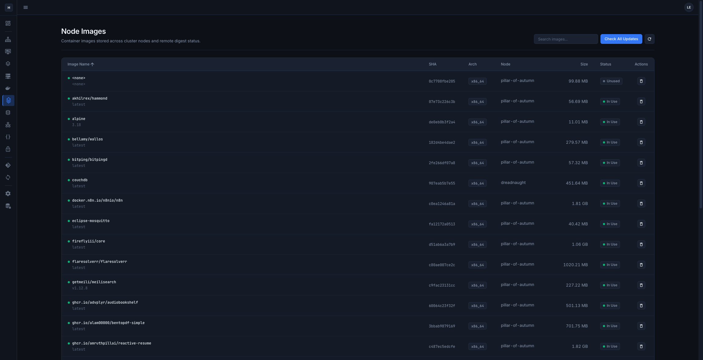

# Images

Cluster-wide inventory of container images stored on individual Swarm nodes, deduplicated per node/repository/tag, with remote digest update checks.

## Columns & Status Indicators
- **Image Name**: Update-check dot (**Up to date** green, **Out of date** red, **Checking** amber, **Unchecked** grey), repository name, and tag on the subtitle line.
- **SHA**: Truncated 12-character image ID in monospace.
- **Arch**: CPU architecture badge (`amd64`, `arm64`, etc.).
- **Node**: Swarm node storing the image.
- **Size**: Formatted on-disk image size.
- **Status**: `In Use` (green dot) or `Unused` (grey dot).
- **Actions**: Delete image button.

## Buttons
- **Search Input**: Filters images by repository, tag, ID, architecture, or node.
- **Check All Updates**: Queries remote registries (using configured credentials in [Registries](/docs/wiki/18.registries.md)) to compare local digests against upstream manifests for all unique image/tag/architecture combinations.
- **Refresh**: Reloads node image inventories.
- **Delete Image**: Opens confirmation to remove an image tag from its node.

## Dialogs
- **Delete Docker Image?**: Shows Image, full ID, Node, a warning banner if the image is in use, and a **Force delete image** (`docker rmi -f`) toggle switch (**Cancel** / **Delete**).
