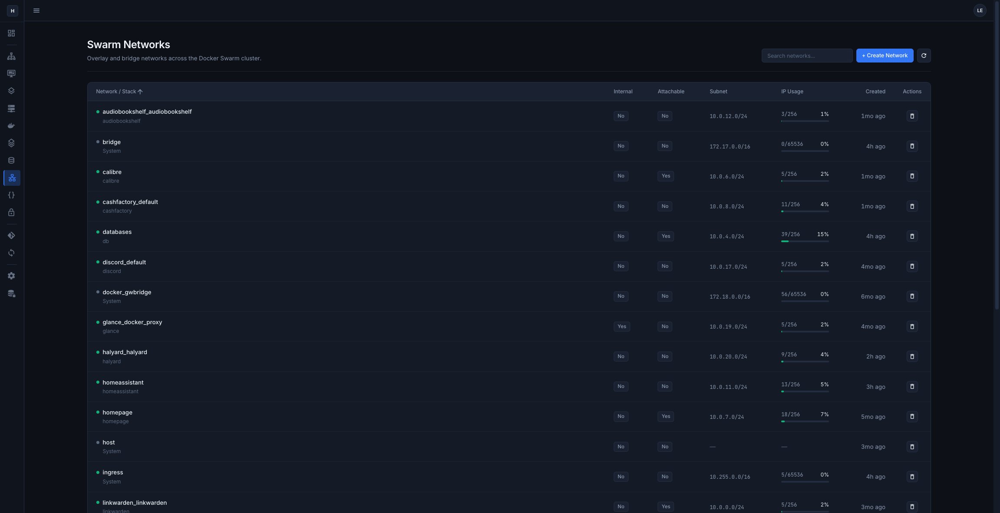

# Networks

Cluster inventory of Swarm overlay, bridge, and host networks, including live IP address pool utilization.

## Columns & Status Indicators
- **Network**: Status dot (green for `swarm`-scoped networks) beside the network name and owning stack subtitle (`System` for non-stack networks).
- **Internal / Attachable**: `Yes` / `No` badges indicating external isolation and standalone container attachability.
- **Subnet**: Allocated IPv4 CIDR subnet (or `—`).
- **IP Usage**: Used vs. total IP capacity (`used/total`, percentage, and threshold progress bar) calculated from the subnet and connected endpoints.
- **Driver / Scope**: Network driver (`overlay`, `bridge`, `host`, `null`) and scope (`swarm`, `local`).
- **Created**: Relative creation timestamp.
- **Actions**: Delete network button.

## Row Actions
- **Clicking a row**: Navigates to [Network Detail](/docs/wiki/15.network-detail.md).

## Buttons
- **Search Input**: Filters networks by name, stack, subnet, driver, or scope.
- **+ Create Network**: Opens the **Create Swarm Network** modal.
- **Refresh**: Reloads cluster networks.
- **Delete Network**: Prompts confirmation to remove the network.

## Dialogs
- **Create Swarm Network**: Configures Network Name, Driver (`overlay` or `bridge`), **Attachable** and **Internal** toggle switches, optional **Subnet (CIDR)** and **Gateway**, and **Enable Encryption (IPSEC)** toggle (for overlay driver).
- **Delete Network? / Network Deletion Failed**: Confirms deletion and displays errors if services or containers remain attached.
