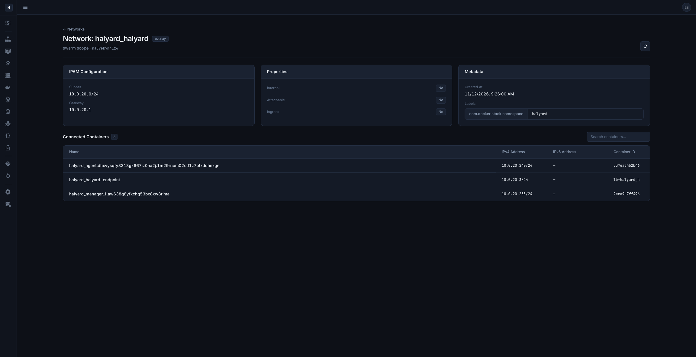

# Network Detail

Detailed IPAM configuration, network flags, metadata, and connected container endpoints for a specific Docker network.

## Sections
- **IPAM Configuration**: Lists configured **Subnet** and **Gateway** pairs for the network.
- **Properties**: Shows **Internal**, **Attachable**, and **Ingress** (`Yes` / `No`) flags.
- **Metadata**: Shows **Created At** timestamp and aligned **Labels** key/value table.
- **Connected Containers**: Searchable table (2-row cards on mobile) listing container **Name**, **IPv4 Address**, **IPv6 Address**, and truncated **Container ID**.

## Row Actions
- **Clicking a connected container row**: Navigates to [Container Detail](/docs/wiki/11.container-detail.md).

## Buttons
- **← Networks**: Returns to the Networks list.
- **Search Input**: Filters connected containers by name, IPv4, IPv6, or ID.
- **Refresh**: Reloads network inspection data from the manager.

## Dialogs
No dialogs are present on this view.
