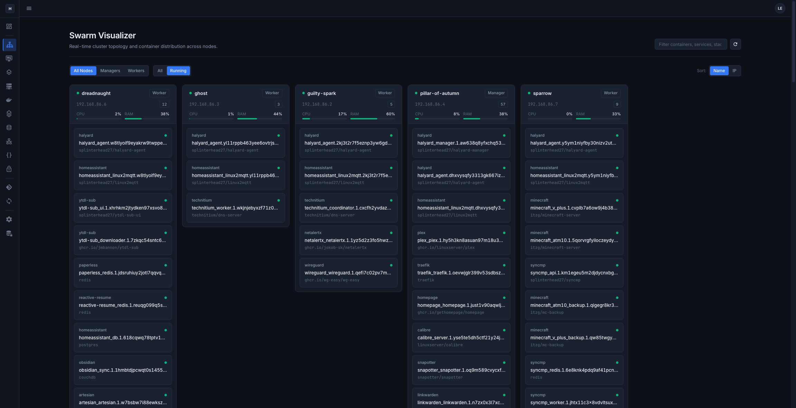

# Swarm Visualizer

Interactive multi-node topology board showing real-time CPU/RAM load and container placement across every node in the cluster.

## Visual Elements & Status Indicators
- **Node Columns**: One card per node showing health dot, hostname, Manager/Worker badge, IP address, matching container count pill, and live **CPU** and **RAM** progress bars. Clicking a node header opens [Node Detail](/docs/wiki/09.node-detail.md).
- **Container Tiles**: Each container scheduled on a node shows its stack name, state dot (**Running** green, **Exited** red, **Paused / Restarting** amber), container name, formatted image, and an **Image update available** indicator when outdated. Clicking a tile opens [Container Detail](/docs/wiki/11.container-detail.md).

## Filters & Controls
- **Search Input**: Filters containers, services, and stacks across all node columns in real time.
- **Role Filter**: Segmented control for **All Nodes**, **Managers**, or **Workers**.
- **State Filter**: Segmented control for **All** or **Running** containers.
- **Sort Nodes**: Toggle sorting node columns by **Name** or **IP**.
- **Refresh**: Reloads live node metrics and container placements.

## Dialogs
No dialogs are present on this view.
