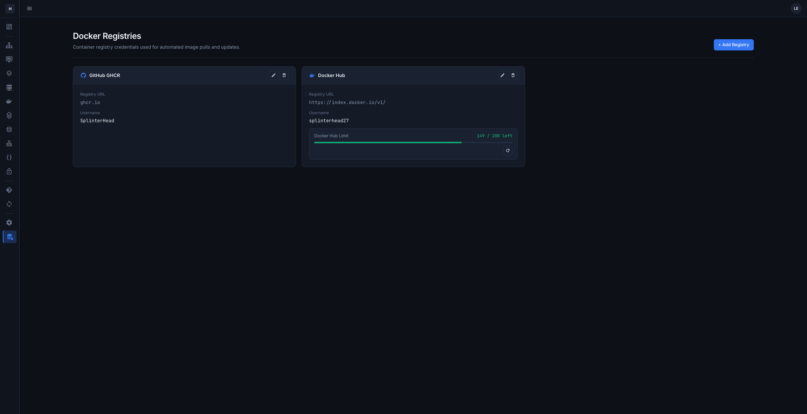

# Docker Registries

Management of private Docker registry credentials and live Docker Hub pull rate-limit monitoring.

## Features & Indicators
- **Anonymous Rate-Limit Banner**: Displayed when no Docker Hub credential is saved, showing remaining anonymous pulls, reset timer, and an **Authenticate Docker Hub** quick action.
- **Registry Cards**: Displays Friendly Name, provider icon, **Registry URL** (`Docker Hub` or custom host), **Username**, and Edit/Delete actions.
- **Docker Hub Limit Meter**: Embedded on Docker Hub cards showing remaining pull quota (`remaining / limit left`), a color-coded progress bar, reset countdown, and manual refresh button.

## Buttons
- **+ Add Registry**: Opens the **Add Registry** modal.
- **Authenticate Docker Hub**: Pre-populates a Docker Hub registry form.
- **Edit Registry**: Opens the **Edit Registry** modal for an existing credential.
- **Delete Registry**: Opens deletion confirmation.
- **Refresh (Rate Limit)**: Queries current Docker Hub pull quota.

## Dialogs
- **Add Registry / Edit Registry**: Includes an optional **Preset** selector (`Docker Hub`, `GitHub Container Registry`, `GitLab Container Registry`, `AWS ECR (Private/Public)`, `Google Artifact Registry`, `Google GCR`, `Red Hat Quay`, `Azure Container Registry`), Friendly Name, Registry URL, Username, and Password / Token.
- **Delete Registry?**: Confirms credential removal (**Cancel** / **Delete**).
