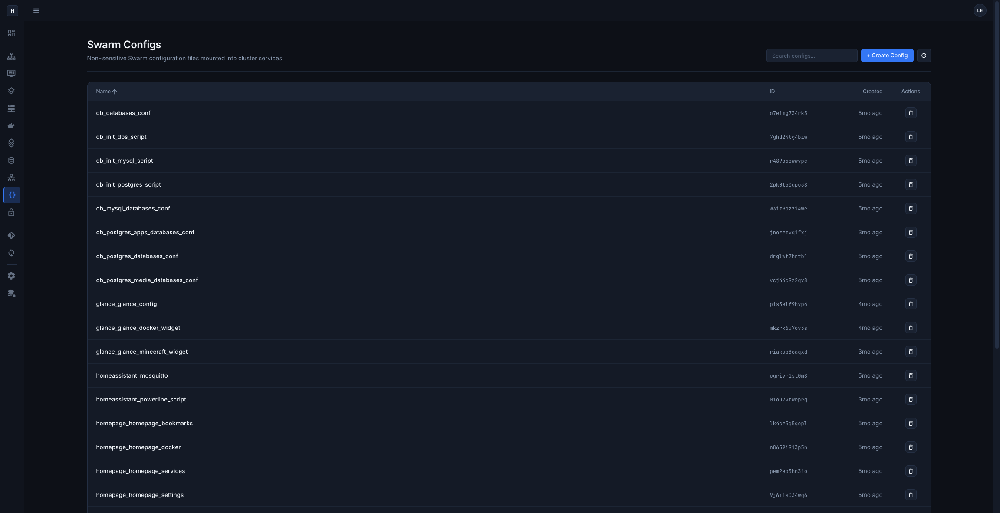

# Configs (Variables)

Management and inspection of non-sensitive Docker Swarm configuration objects (`docker config`), accessible at `/swarm/variables`.

## Columns
- **Name**: Friendly config name (strips Swarm version suffixes like `-v1`).
- **ID**: Truncated 12-character Swarm config ID.
- **Created**: Relative creation timestamp.
- **Actions**: Remove config button.

## Row Actions
- **Clicking a row**: Opens the **View Config** modal displaying the stored non-sensitive configuration content.

## Buttons
- **Search Input**: Filters configs by name or ID.
- **+ Create Config**: Opens the **Create Swarm Config** modal.
- **Refresh**: Reloads Swarm configs from the manager.
- **Remove Config**: Prompts confirmation to delete the configuration.

## Dialogs
- **Create Swarm Config**: Accepts **Config Name** and **Config Data** (multiline monospace editor) (**Cancel** / **Create**).
- **View Config**: Read-only modal displaying the decoded config content (**Close**).
- **Remove Config?**: Confirms deletion (fails if mounted by any active Swarm service) (**Cancel** / **Remove**).
