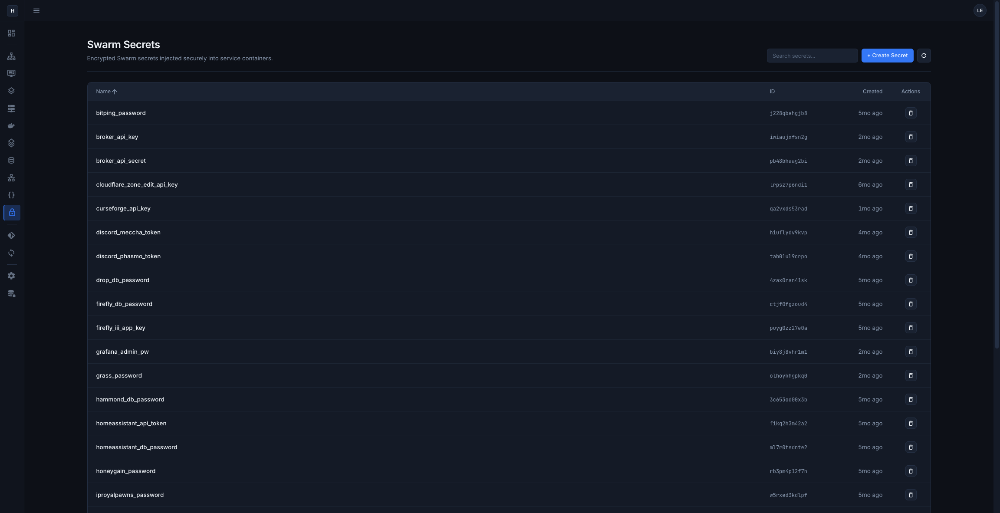

# Secrets

Management of encrypted Docker Swarm secrets injected securely into service containers.

> Secret values are write-only in Docker Swarm and are never readable back through the UI once created.

## Columns
- **Name**: Swarm secret name.
- **ID**: Truncated 12-character Swarm secret ID.
- **Created**: Relative creation timestamp.
- **Actions**: Remove secret button.

## Buttons
- **Search Input**: Filters secrets by name or ID.
- **+ Create Secret**: Opens the **Create Swarm Secret** modal.
- **Refresh**: Reloads secret metadata from the manager.
- **Remove Secret**: Prompts confirmation to delete the secret.

## Dialogs
- **Create Swarm Secret**: Accepts **Secret Name** and **Secret Data** (multiline monospace editor) (**Cancel** / **Create**).
- **Remove Secret?**: Confirms removal (fails if currently referenced by any active service) (**Cancel** / **Remove**).
