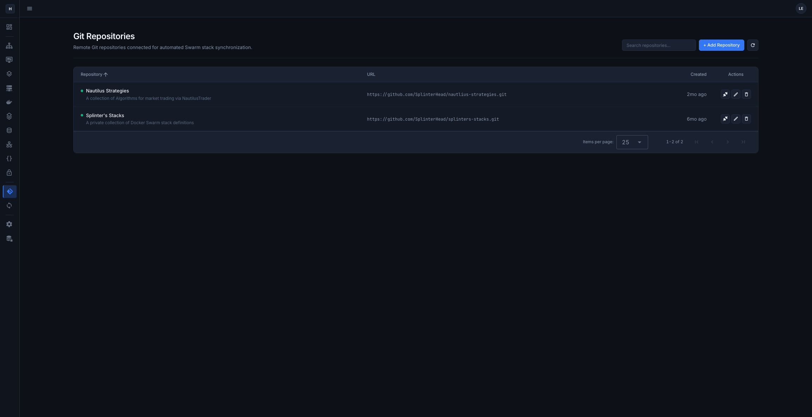

# Git Repositories

Management of remote Git repositories connected for automated Swarm stack synchronization.

## Columns & Status Indicators
- **Repository**: Status dot (**Success** green / **Failed** red based on the last connection/fetch check), friendly repository name, and full description beneath.
- **URL**: Remote Git clone URL in monospace.
- **Created**: Relative creation timestamp.
- **Actions**: **Test Connection**, **Edit Repository**, and **Delete Repository** buttons.

## Buttons
- **Search Input**: Filters repositories by name, description, or URL.
- **+ Add Repository**: Opens the **Add Git Repository** modal.
- **Refresh**: Reloads configured repositories.
- **Test Connection**: Verifies network and authentication access to the remote Git repository.
- **Edit Repository / Delete Repository**: Updates credentials/metadata or deletes the repository.

## Dialogs
- **Add / Edit Git Repository**: Configures **Friendly Name**, **Git URL**, optional **Username**, optional **Token / Password**, and **Description** (**Cancel** / **Add** or **Save**).
- **Delete Repository?**: Confirms deletion and warns that all associated Git Syncs will also be removed (**Cancel** / **Delete**).
