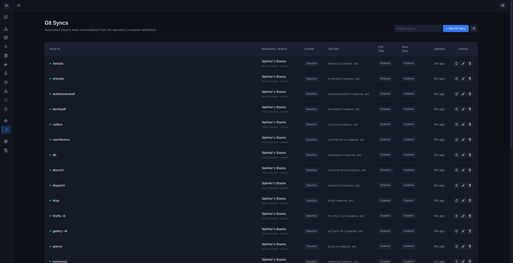

# Git Syncs

Configuration and reconciliation status of mappings between Git repository compose files and Docker Swarm stacks.

## Columns & Status Indicators
- **Stack**: Status dot and name (**Out of Date** amber when remote drift/failure is present, **Syncing** blue, **Ready** green/grey).
- **Repository / Branch**: Linked repository friendly name and tracked Git branch.
- **Commit SHA**: Short 7-character SHA badge of the last applied commit (or `Never`).
- **Path**: Monospace path to the compose file within the repository.
- **Additional Files**: `Enabled` / `Disabled` badge indicating whether sibling files (such as `.env`) are pulled alongside the compose file.
- **Auto Sync**: `Enabled` / `Disabled` badge controlling periodic reconciliation.
- **Updated**: Relative timestamp of the last sync (or `Never`).
- **Actions**: **Force Sync Now**, **Edit Sync**, and **Delete Sync** buttons.

## Buttons
- **Search Input**: Filters syncs by stack name, repository, branch, or file path.
- **+ Add Git Sync**: Opens the **Add Git Sync** modal.
- **Refresh**: Reloads sync states from the manager.
- **Force Sync Now**: Triggers immediate pull and `docker stack deploy` reconciliation.
- **Edit Sync / Delete Sync**: Modifies sync settings or deletes the sync mapping.

## Dialogs
- **Add / Edit Git Sync**: Configures **Stack Name** (lowercase letters, numbers, and dashes), **Git Repository**, dynamically fetched **Branch**, **Compose File Path** (with **Browse** repository file picker), **Additional Files** toggle switch, and **Auto Sync** toggle switch.
- **Browse Repository**: Interactive file browser for the selected repository and branch highlighting `.yml`/`.yaml` files (**Up** navigation and directory traversal).
- **Delete Git Sync?**: Stops automated reconciliation for the stack without removing the running stack from Swarm (**Cancel** / **Delete**).
