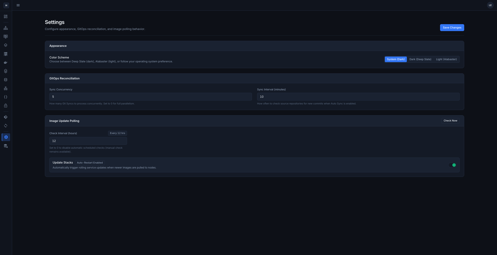

# System Settings

Global configuration for UI appearance, GitOps reconciliation scheduling, and automated container image update polling.

## Configuration Panels

### 1. Appearance
- **Color Scheme**: Instant segmented control switching between **System** (tracks OS dark/light preference), **Dark (Deep Slate)**, and **Light (Alabaster)**.

### 2. GitOps Reconciliation
- **Sync Concurrency**: Numeric input (`0`–`20`) controlling how many Git Syncs run concurrently (`0` for unrestricted parallelism).
- **Sync Interval (minutes)**: Numeric input (`1`–`60`) defining how often remote Git branches are polled when Auto Sync is enabled.

### 3. Image Update Polling
- **Check Interval (hours)**: Numeric input (`0`–`72`) defining how frequently Halyard scans unique image+platform combinations across the Swarm (`0` disables scheduled checks while keeping manual checks available).
- **Update Stacks**: Toggle switch (`role="switch"`) controlling whether services using newly pulled images are automatically restarted with zero-downtime rolling updates (`ServiceUpdate` with stale digest clearing).
- **Check Now**: Immediately runs a cluster-wide image update poll and displays scanned/updated image and restarted service counts.

## Buttons
- **Save Changes**: Persists GitOps and Image Update Polling settings to the SQLite database.
- **Check Now**: Triggers an on-demand cluster-wide image update check.

## Dialogs
No dialogs are present on this view.
