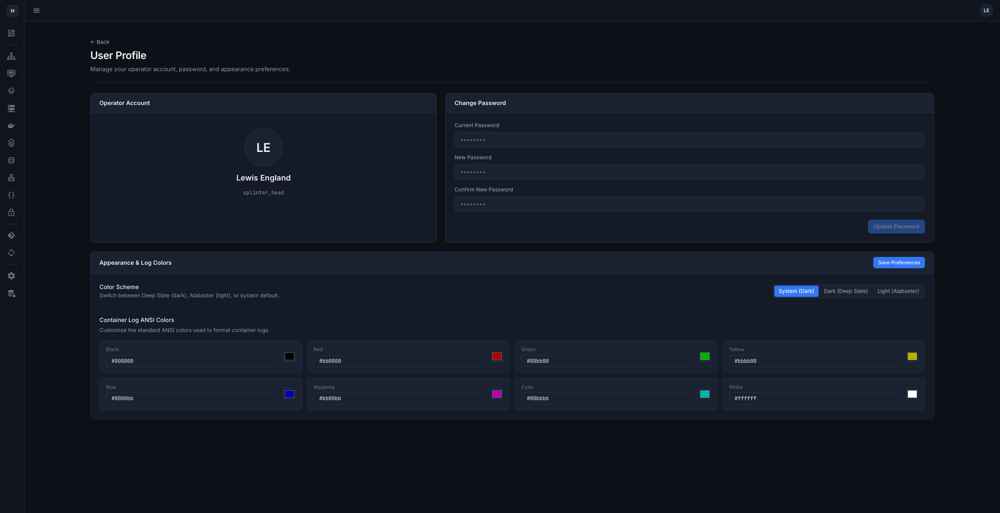

# User Profile

Operator account management, password updates, theme selection, and container log ANSI color customization (`/settings/profile`).

## Sections
- **Operator Account**: Displays user initials avatar, Real Name, and system Username.
- **Change Password**: Validates Current Password, New Password (minimum 8 characters), and Confirm New Password before updating credentials.
- **Appearance & Log Colors**:
  - **Color Scheme**: Segmented control matching Settings (**System**, **Dark (Deep Slate)**, **Light (Alabaster)**).
  - **Container Log ANSI Colors**: Customizes all 8 standard ANSI foreground colors (`Black`, `Red`, `Green`, `Yellow`, `Blue`, `Magenta`, `Cyan`, `White`) using hex inputs or native color pickers for [Container Detail Logs](/docs/wiki/11.container-detail.md).

## Buttons
- **← Back**: Navigates back to the previous page.
- **Update Password**: Saves the new operator password.
- **Save Preferences**: Persists the operator's theme and custom ANSI log palette to the database.

## Dialogs
No dialogs are present on this view.
