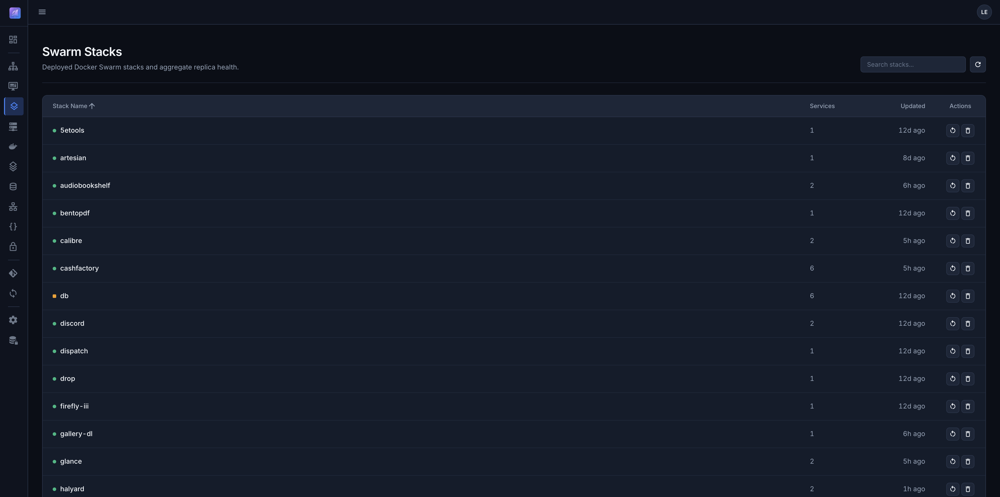
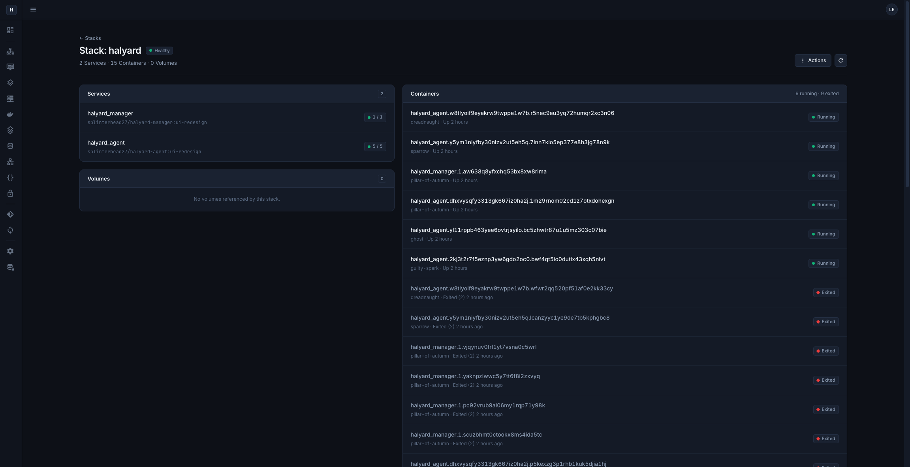
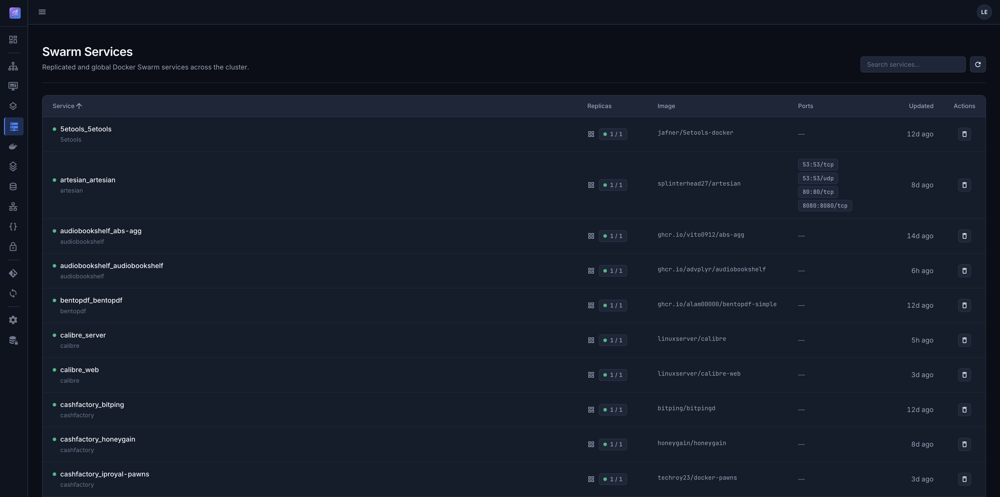
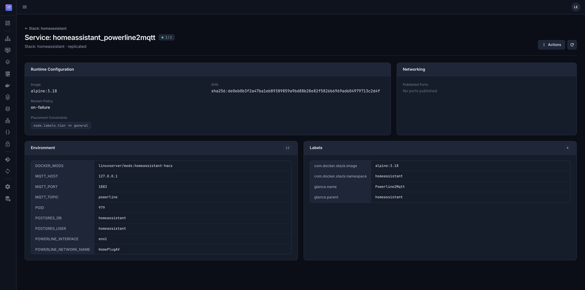
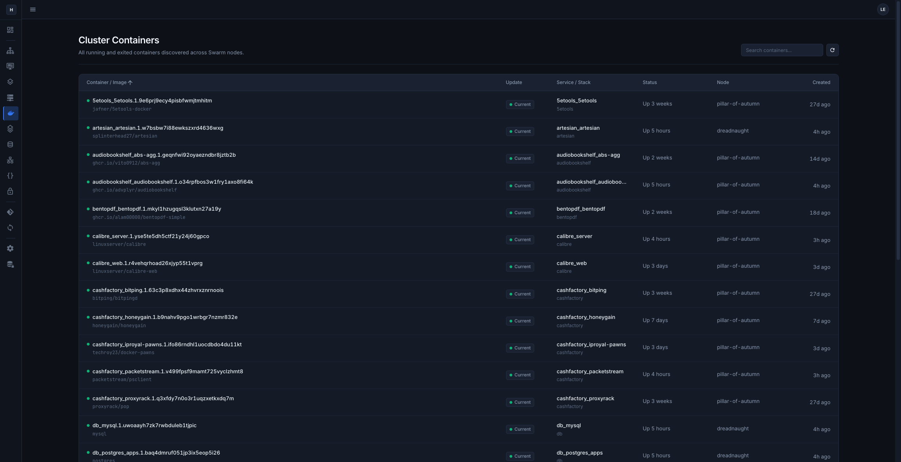
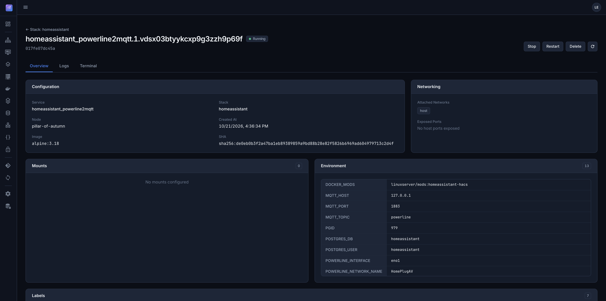

# Workloads: Stacks, Services & Containers

Halyard provides a cohesive drill-down workflow from high-level Swarm **Stacks** down to individual **Services** and live **Container** shells.

---

## Stacks & Stack Detail

### Stacks List (`/swarm/stacks`)

The **Stacks** table groups Swarm services by `com.docker.stack.namespace`, with standalone/unstacked services collected under `Orphaned/Manual`:

Each row displays the stack health indicator (`Healthy` green vs. degraded amber), total number of services, relative last-updated timestamp, and quick actions (**Force Restart** and **Delete Stack**, omitted for `Orphaned/Manual`).

When deleting a stack, the confirmation modal offers a **Delete associated volumes** toggle switch so you can choose whether persistent stack volumes are preserved or permanently deleted alongside the stack.

### Stack Detail (`/swarm/stacks/:name`)

Clicking a stack opens a structured view of everything running inside that namespace:

- **Services Card**: Lists every service in the stack with its image tag and `running / replicas` health badge; clicking jumps to **Service Detail**.
- **Volumes Card**: Lists volumes referenced by the stack, labeled **Managed** or **External**.
- **Containers Card**: Lists running and exited container tasks for the stack alongside their host node and status summary; clicking jumps to **Container Detail**.
- **Cluster Tasks Table**: Searchable, paginated (`25` items per page) task table showing **Service**, **Node**, **State** (`Running`, `Failed`, `Shutdown`, `Rejected`, `Orphaned`, `Starting`), **Desired** state, **Error / Status** (for troubleshooting scheduling or startup failures), and **Updated** timestamp.
- **Stack Actions**: Use the header **Actions** menu on managed stacks to **Force Restart**, **Stop (Scale to 0)**, **Start Services**, **Rollback Spec**, or **Delete Stack**.

---

## Services & Service Detail

### Services List (`/swarm/services`)

The **Services** view lists every replicated and global Swarm service across the cluster:

- **Service**: Status dot (green when desired replicas are met, red when zero are running for a non-zero target, amber otherwise), service name, and owning stack subtitle.
- **Replicas**: Scheduling mode icon on the left (globe for `global`, four-square grid for `replicated`) beside the `running / replicas` badge.
- **Image & Ports**: Monospace image reference and published port badges (`80:80/tcp`, etc.).
- **Actions**: Delete service directly from the list with API error reporting if removal fails.

### Service Detail (`/swarm/services/:id`)

Clicking a service opens its configuration and lifecycle controls:

- **Runtime Configuration**: Separates **Image** (`image:tag`) and **SHA** (`sha256:...`) into two distinct fields, alongside **Restart Policy** and **Placement Constraints**.
- **Networking**: Displays all **Published Ports** exposed by the service.
- **Environment & Labels**: Aligned key/value grids listing injected environment entries and Swarm service labels.
- **Service Actions**: Header **Actions** menu provides **Force Restart**, **Stop (Scale to 0)**, **Start Service**, **Rollback Spec**, **Scale Service** (numeric desired replica modal), and **Delete Service**. (`Stop`, `Start`, and `Scale` are disabled for `global` services whose replica count tracks matching Swarm nodes.)

---

## Containers, Live Logs & Interactive Terminal

### Containers List (`/swarm/containers`)

The **Containers** view aggregates all running and exited containers reported by every node agent:

Columns surface the container name, formatted image name, **Update** status badge (**Current** green vs. **Out of Date** amber), owning **Service / Stack**, runtime **Status** (`Up ...`), host **Node**, and **Created** timestamp.

### Container Detail (`/swarm/containers/:id`)

Clicking a container opens a three-tab workspace (**Overview**, **Logs**, **Terminal**) alongside header **Stop / Start**, **Restart**, **Delete** (with a **Force delete** toggle switch), and **Refresh** actions:

#### 1. Overview Tab
- **Configuration**: Owning **Service**, **Stack**, **Node**, **Created At**, and split **Image** / **SHA** fields.
- **Networking**: Attached Docker networks and exposed host/container ports (`public:private/protocol`).
- **Mounts**: Table of volume and bind mounts (`Source`, `Destination`, `Type`, plus `RW`/`RO` on mobile).
- **Environment & Labels**: Aligned key/value tables of runtime variables and container labels.

#### 2. Logs Tab
- Streams live stdout/stderr over WebSocket directly from the container's node agent.
- Stays bounded cleanly inside the viewport height with inner scrolling so outer page scrolling is never needed.
- Toolbar controls include **Line Numbers** and **Timestamps** toggle switches, **Auto-scroll**, and **Clear**.
- Renders ANSI color sequences using the customizable 8-color palette defined in [User Profile](settings-and-security.md#user-profile--ansi-log-colors).

#### 3. Terminal Tab
- Launches an interactive browser PTY shell inside the container using `xterm.js` over WebSocket.
- Stays bounded inside the viewport and automatically recalculates terminal rows/columns via `ResizeObserver` as the window changes size.
- Lets you choose a shell (`/bin/bash`, `/bin/sh`, `/bin/zsh`, or `/bin/ash`) and click **Connect** / **Disconnect**.

---

← [Cluster Observability & Nodes](cluster-observability.md) · Next: **[Storage, Images, Networks & Secrets](storage-and-networking.md)** →
